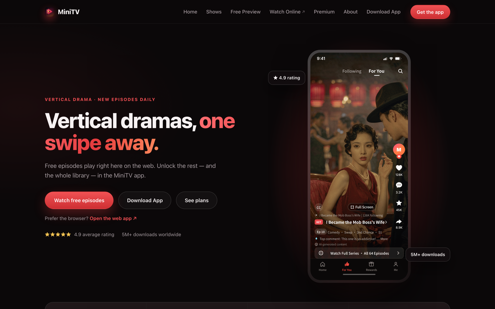
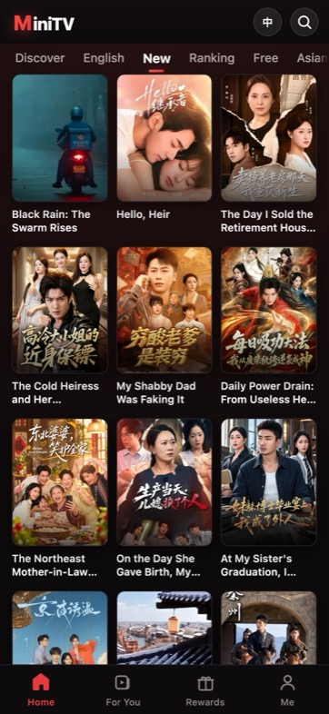
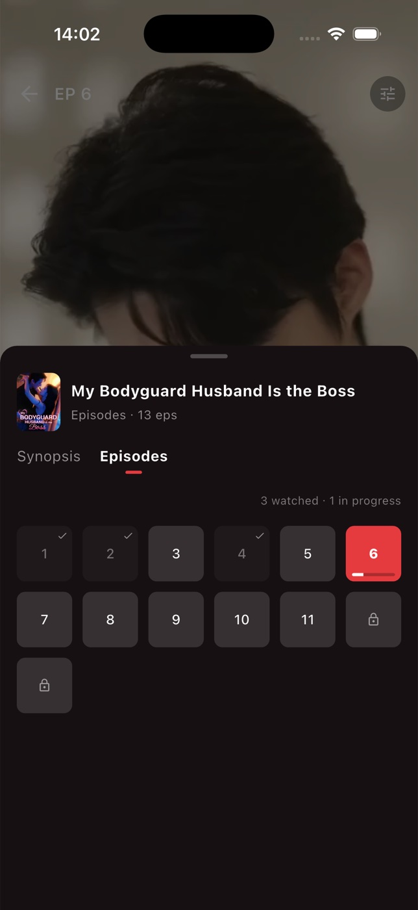
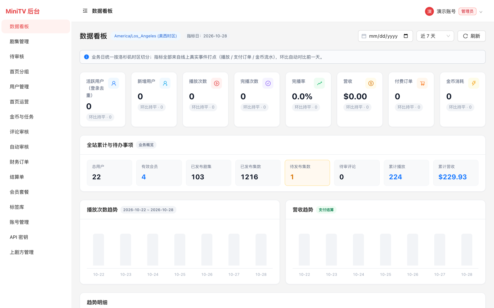
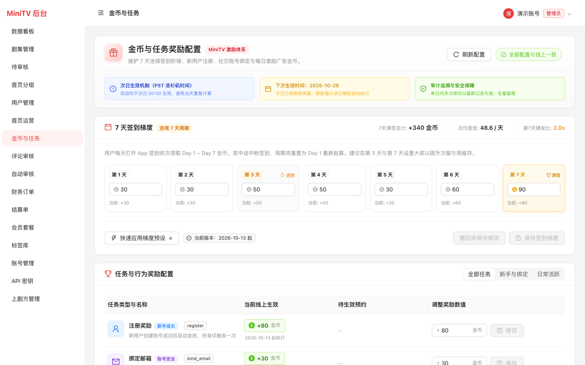

<div align="center">

<h1>MiniTV</h1>

<p><strong>开源的短剧分发平台</strong> —— 内容方入驻上传、平台审核分发、分集解锁与结算，一套后端撑起官网 / H5 / App / 后台。</p>

<p>React 18 · TypeScript · FastAPI · PostgreSQL · Redis · Flutter · Bunny Stream · Stripe</p>

</div>

---

## 在线演示

| 端 | 地址 | 说明 |
| --- | --- | --- |
| 🖥 官网（营销站） | <https://minitv.us> | 产品介绍、免费试看、套餐展示 |
| 📱 H5 Web App | <https://h5.minitv.us> | 完整播放、金币、签到、评论，移动端优先 |
| 🔐 管理后台 | <https://admin.minitv.us> | 内容 / 运营 / 财务后台，需登录 |
| ⚙️ API | <https://api.minitv.us> | 接口服务，文档见 `/docs` |

> 演示站由维护者提供，仅用于体验产品；请勿用于压测或爬取。

## 产品演示

<table>
<tr>
<td width="100%">

<br><sub><b>官网</b> —— 首屏讲清价值主张，右侧真机模型预演产品界面，主 CTA 直达免费试看。</sub>
</td>
</tr>
</table>

<table>
<tr>
<td width="33%" align="center">

<br><sub><b>H5 · 首页</b><br>Discover / Ranking / Free 多频道，主推位轮播</sub>
</td>
<td width="33%" align="center">

<br><sub><b>H5 · 新剧</b><br>最新上架一屏尽览，三列纵向浏览</sub>
</td>
<td width="33%" align="center">

<br><sub><b>App · 选集</b><br>已看 / 在追 / 加锁三态一目了然</sub>
</td>
</tr>
</table>

<table>
<tr>
<td width="50%">

<br><sub><b>后台 · 数据看板</b> —— 活跃、播放、完播、营收按日聚合，全站累计与待办一屏掌握。</sub>
</td>
<td width="50%">

<br><sub><b>后台 · 金币与任务</b> —— 7 天签到阶梯与任务激励可在线上直接调参，次日生效、全程留痕。</sub>
</td>
</tr>
</table>

## 功能

**内容与播放**

- 剧集 / 分集 / 标签 / 首页楼层可视化编排，支持定时上架与批量上传
- Bunny Stream 转码 + HLS 签名播放，多清晰度切换、断点续播
- 分集解锁：免费集数、金币单价、会员权益三级控制

**变现与增长**

- Stripe Checkout 会员，支持「自动续费订阅」与「一次性时长包」两种计费模式，后台一键切换
- 金币账本（append-only 流水 + 物化余额），所有消耗走幂等接口，杜绝重复扣费
- 7 天签到阶梯、每日任务、绑定奖励，奖励配置后台可调、按生效日归档

**运营与协作**

- 分集评论 + 异步 AI 审核（OpenAI 兼容接口，密钥在后台加密存储）
- 上剧方（supplier）独立角色：自助建剧、上传、提交审核，只读对账单
- 管理后台 RBAC（运营 / 财务 / 管理员）、API Key + CLI、全量审计日志
- 数据看板、财务订单、月度结算单

## 技术栈

| 层 | 选型 |
| --- | --- |
| 后端 | FastAPI · SQLAlchemy 2 · Alembic · psycopg3 · PyJWT |
| 数据 | PostgreSQL 16 · Redis 7 |
| 前端 | React 18 · TypeScript 5 · Vite 5 · Ant Design 5 |
| App | Flutter（Dart SDK 3.13+，iOS / Android） |
| 媒体 | Bunny Stream（HLS 转码）· Bunny Storage + Optimizer（封面 / 字幕） |
| 支付 | Stripe Checkout + Webhook |
| 邮件 | Resend |
| 部署 | Cloudflare R2 托管静态站 · 单台 Linux 跑 API |

## 目录结构

```
.
├── backend/            FastAPI 服务
│   ├── app/modules/    业务模块：account / content / playback / wallet /
│   │                   billing / social / ops / recommend / analytics
│   ├── alembic/        数据库迁移
│   └── tests/          pytest 用例（隔离库，跑前自动建表）
├── admin/              管理后台（React + Ant Design）
├── web/                官网营销站（React，含独立隐私政策页）
├── h5/                 移动端 Web App（React）
├── app/                Flutter App（iOS / Android）
├── cli/                单文件 CLI（纯标准库，Python 3.8+）
├── scripts/            数据导入、发布、运维脚本
├── docs/               架构 / 运营 / 验收文档
├── deployments/        发布记录（每次发布自动生成 JSON）
└── docker-compose.yml  本地 PostgreSQL + Redis
```

## 快速开始

### 前置要求

- Python **3.11+**
- Node.js **18+**
- Docker（跑本地 PostgreSQL / Redis）
- 可选：Flutter 3.x（只在跑 App 时需要）

### 1. 拉代码并准备环境变量

```bash
git clone https://github.com/xuliang2024/minitv.git
cd minitv
cp .env.example .env
```

`.env.example` 默认 `BUNNY_MODE=fake`，播放与封面走本地桩实现 —— **不填任何外部密钥也能把接口和后台跑通**。

### 2. 起依赖服务

```bash
docker compose up -d      # PostgreSQL :15432 / Redis :16379
```

### 3. 装后端依赖并建表

```bash
python3 -m venv .venv
source .venv/bin/activate
pip install -r backend/requirements.txt

cd backend && alembic upgrade head && cd ..
```

### 4. 启动 API

```bash
.venv/bin/uvicorn app.main:app --app-dir backend --host 127.0.0.1 --port 18110
```

健康检查：`curl http://127.0.0.1:18110/health`

> 快捷方式：`./scripts/up-local.sh` 会一次性起好 Docker 依赖和 API。

### 5. 启动三个前端

三个终端分别执行：

```bash
cd admin && npm install && npm run dev     # http://127.0.0.1:5173
cd web   && npm install && npm run dev     # http://127.0.0.1:5174
cd h5    && npm install && npm run dev     # http://127.0.0.1:5175
```

Vite 已配好代理，`/v1` 与 `/admin/v1` 会自动转发到 `127.0.0.1:18110`，无需额外配置跨域。

### 6. 创建第一个后台账号

```bash
cd backend
SEED_ADMIN_PASSWORD='换成你自己的口令' ../.venv/bin/python -m app.seed_admin
```

不带 `SEED_ADMIN_PASSWORD` 时会随机生成一个并打印一次。该脚本只在 `admin_users` 为空时执行，可安全重复运行。

打开 <http://127.0.0.1:5173>，用这个账号登录。

### 本地端口一览

| 服务 | 地址 |
| --- | --- |
| API | <http://127.0.0.1:18110> |
| 管理后台 | <http://127.0.0.1:5173> |
| 官网 | <http://127.0.0.1:5174> |
| H5 | <http://127.0.0.1:5175> |
| PostgreSQL | `127.0.0.1:15432` |
| Redis | `127.0.0.1:16379` |

### 可选：灌一些演示数据

```bash
cd backend
../.venv/bin/python -m app.seed_rewards          # 签到 / 任务基线配置
../.venv/bin/python -m app.seed_users --count 20 # 假 C 端用户与钱包
../.venv/bin/python -m app.seed_catalog_episodes # 从本地片库导入剧集（需自备 catalog）
```

### 环境自检

```bash
python3 scripts/check_local_env.py
```

检查 `.env`、PostgreSQL、Redis 与 Python 依赖；Flutter / Android / iOS 工具链单独报告，不影响后端启动。

## 运行 App

```bash
cd app
flutter pub get

# iOS 模拟器（默认就连本机 API）
flutter run

# Android 模拟器 / 真机需要显式指定 API 地址
flutter run --dart-define=API_BASE=http://10.0.2.2:18110
```

## 命令行工具

`cli/minitv` 是单文件、零依赖的 CLI（Python 3.8+，当前 0.4.0），覆盖剧集 / 分集 / 标签 / 分组 / 排期 / 上传 / 上剧方等 **57 条命令**。

```bash
curl -fsSL https://minitv.us/cli/install.sh | sh
minitv config set-key                      # 交互式写入 API Key（不落 shell 历史）
minitv drama list --status published
minitv episode upload 12345 ./ep01.mp4
minitv doctor                              # 自检：连通 / 身份 / 权限
```

完整命令见 [`docs/cli-reference.md`](docs/cli-reference.md)。

## 发布

线上发布统一走一个入口，内含共享锁与自动版本号：

```bash
python3 scripts/release.py status          # 先看锁和线上版本
python3 scripts/release.py r2   --dist web/dist --source web
python3 scripts/release.py run  --target server -- ./scripts/deploy_server.sh
```

版本形如 `v2026.10.29.1`，由脚本在锁内生成并打 tag；回滚同样走脚本。细节见 [`docs/release-process.md`](docs/release-process.md)。

> 这些日期构建号属于**本地部署记账**，权威记录是 `deployments/releases/*.json`（含版本号与提交 SHA）。它们不推送到远端——公开仓库只保留语义化版本 tag，当前为 [`v1.0.0`](https://github.com/xuliang2024/minitv/releases/tag/v1.0.0)。

## 文档

| 文档 | 内容 |
| --- | --- |
| [`docs/technical-architecture.md`](docs/technical-architecture.md) | 技术拓扑、密钥边界、部署架构 |
| [`docs/release-process.md`](docs/release-process.md) | 发布 / 回滚流程与故障处理 |
| [`docs/membership-coins-unlock.md`](docs/membership-coins-unlock.md) | 会员、金币、解锁的账务设计 |
| [`docs/comment-architecture.md`](docs/comment-architecture.md) | 评论与异步审核链路 |
| [`docs/supplier-role-plan.md`](docs/supplier-role-plan.md) | 上剧方角色的权限与结算设计 |
| [`docs/cli-reference.md`](docs/cli-reference.md) | CLI 全部命令 |

## 交流与反馈

部署踩坑、功能建议、想聊聊短剧出海怎么做，都欢迎。

<p align="center"></p>

<p align="center"><strong>扫码加微信，备注「MiniTV」，拉你进交流群</strong></p>

遇到 Bug 也可以直接开 [Issue](https://github.com/xuliang2024/minitv/issues)。

## 许可证

本项目基于 [MIT License](LICENSE) 开源，© 2026 MiniTV。

可自由用于商业项目，保留版权声明即可。如需改为 Apache-2.0（附带专利授权条款），替换 `LICENSE` 文件并同步本节即可。
