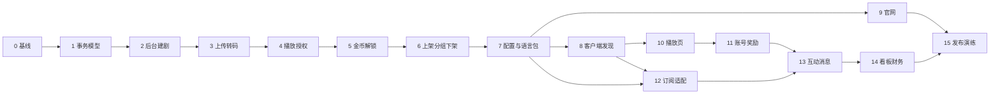

# MiniTV 分阶段开发计划

状态：待评审后按阶段推进  
日期：2026-10-13  
读者：后端、管理后台、客户端、官网、测试  
推进方式：一次只做一个阶段。本阶段验收未通过，不开始下一阶段。

依据：

| 文档 | 用途 |
|---|---|
| [软件架构设计](software-architecture.md) | 模块边界、状态机、一致性、安全 |
| [技术架构](technical-architecture.md) | 运行时、Bunny、R2、密钥和发布 |
| [前后端开发文档](../output/minitv-devdoc-20261013/stage1/final_draft.md) | 页面、字段、12 条验收清单 |
| App 设计稿 file `735952778351359` | 客户端 19 屏，360pt |
| 官网与管理后台设计稿 file `735989669924027` | 官网单页；后台 1440×900，现行 16 屏 |
| `LiteTV 短剧 App 设计稿.pptx` | 早期中文视觉参考，不是界面验收基准 |
| 设计画板导出的 PNG | 界面还原的唯一对比基准。见第 4.1 节 |

开发文档没有画出的能力不进入本期。架构标为待确认的项目只留字段或适配层，不新开服务。

## 1. 当前基线

2026-10-13 已核对：

| 项 | 状态 | 证据 |
|---|---|---|
| 本地 PostgreSQL 16 | 可用 | `GET /health` 返回 `postgres: 16.13` |
| 本地 Redis 7 | 可用 | `GET /health` 返回 `redis: 7.4.6` |
| FastAPI | 只有健康检查 | `backend/app/main.py` |
| 业务表、迁移、鉴权、内容接口 | 未开始 | 无 Alembic、无 `/v1` |
| 管理后台、官网、Flutter 工程 | 未开始 | 仓库中不存在 |
| Android 模拟器 | 可用 | AVD `Pixel_6_API34` |
| Flutter | 已安装 | `flutter --version` 返回 3.47.7 stable（`~/development/flutter`）；旧检查脚本因仅查 PATH 误报缺失，已修复探测 |
| iOS Simulator runtime | 未安装 | 同上 |
| Bunny 开发账号 | Key 有效，资源为空 | Storage / Stream / Pull Zone 均为 0，不能当生产用 |

阶段 0 不把 Flutter、Android 模拟器和 iOS 运行时算作失败。它们是阶段 8 开工前的环境门。

## 2. 推进规则

1. 每个阶段都是一条能演示的纵切，不按“先把所有表建完、再做所有页面”推进。
2. 阶段内部固定五步：接口契约、自动化测试、按设计稿实现界面、同尺寸截图对比、差异归零。测试失败不补界面。对比未通过，阶段不算通过。
3. 写接口必须带 `Idempotency-Key` 和 `X-Request-Id`。金币、签到、订阅回调和后台调账靠数据库唯一约束，不靠内存。
4. 公开接口只返回已上架剧集和已发布分集。草稿、审核中、下架只出现在后台和授权预览。
5. 视频二进制不进 FastAPI。上传走 Bunny 直传；本地没有 Bunny 资源时，用可替换的假上传器完成验收，不把假地址写进客户端。
6. 价格、文案、下载地址和功能开关从服务端读取。生产密钥不进镜像、不进前端包、不进仓库。
7. 每个阶段结束时，在 `docs/acceptance/phase-XX.md` 留下命令输出或截图路径，并在本文第 12 节更新状态与证据摘要。没有证据不算通过。
8. 待确认项用配置开关占位。确认前不把 Apple、Google、1080P 策略或年龄分级规则写死在客户端。
9. 有界面的阶段，功能通过不能代替还原通过。缺设计基准图、实现截图或叠图，状态只能写「界面未通过」。

## 3. 本期不做

- 管理后台「系统设置」页面。
- 离线下载、下载任务、本地文件管理。播放设置里的 Download 保持不可用。
- 关注列表、粉丝列表、评论发布的完整线程。
- 推送人群定向、A/B 和到达率分析。
- 多币种、税务、商店分成，以及未确认的支付服务商正式接入。
- 设计稿归档区的旧版剧集列表、旧编辑弹窗、旧删除确认。
- TikTok Minis。它有独立规划，不进入主路径；见第 11 节。
- 自建转码、自建播放 CDN、用 FastAPI 托管前端、把视频放进 R2、多区域写数据库。

## 4. 开工假设

这些假设只服务排期。对应阶段的环境门未通过时停下来，不临时换栈。

| 项 | 假设 | 冻结门 |
|---|---|---|
| 后端 | 一个 FastAPI 项目，按内容、播放、账号、资产、订阅、互动、运营、统计分模块 | 阶段 1 |
| 数据 | PostgreSQL 事务表 + Redis 缓存/队列；迁移用 Alembic，只做向后兼容变更 | 阶段 1 |
| 管理后台与官网 | React + TypeScript + Vite。组件库在阶段 2 选定后不更换 | 阶段 2 |
| 客户端 | Flutter。播放器只封装 AVPlayer / ExoPlayer，不自研解码 | 阶段 8 开工前必须确认 |
| 类型 | FastAPI OpenAPI 生成 TypeScript 与 Dart 模型，不手写第二份 | 阶段 2 / 阶段 8 |
| 设备验收 | 先 Android 模拟器。iOS 缺 runtime 时不阻塞 Android 验收 | 阶段 8 |
| Bunny | 开发、预发、生产的 Library、Storage Zone、Pull Zone 分开 | 阶段 3 接真 Bunny 前 |
| 支付 | 订阅服务后留适配层。阶段 10 用本地假回调验收，不接真实收银 | 支付渠道确认前 |

界面不另起视觉体系。标记只用于对照，不能代替画板：

- 客户端画板 360pt。底 `#0C0A0B`，主红 `#E53B3E`，金 `#F5B942`，面板 `#171013`，页边距 16，海报 3:4，卡片圆角 8–12。底栏四等分，图标中心在 45 / 135 / 225 / 315。
- 底部导航只有 Home、For You、Rewards、Me。品牌写 MiniTV，不写 LiteTV。
- 客户端默认英文，后台默认中文。官网英文、深色、1440 宽。后台浅色、1440×900。
- 组件库只是实现手段。默认表格、默认按钮和默认间距如果和画板不一致，改到一致。

还原对比的基准、截图和失败条件见第 4.1 节。


## 4.1 界面还原对比

功能做对但长得不像，阶段不通过。每一屏都要和设计画板的最终帧对比，不和记忆、不和 PPT、不和组件库示例对比。

### 哪张图算基准

| 端 | 唯一基准 | 画板 | 对比语言 |
|---|---|---|---|
| 客户端 19 屏 | file `735952778351359` 在 2026-10-13 15:30 英文化之后的帧 | 360pt 宽，无设备外框 | 先英文，再中文复验溢出 |
| 管理后台现行 16 屏 | file `735989669924027` 的现行帧 | 1440×900，浅色 | 中文 |
| 官网 | 同一文件 y0 的 Landing | 1440 宽长页，深色 | 英文 |

这些图不能当基准：

- `LiteTV 短剧 App 设计稿.pptx`。它是早期中文稿，底栏和文案都已过期。
- 归档画板：剧集列表 `3:464`、旧编辑 `3:643`、旧预览 `3:1849`、旧删除确认 `3:1667`。
- `assets/web/ph_play.png` 与 `ph_play2.png` 同时存在，不能靠文件名猜哪张是最终播放页。
- `assets/web/*_p.png` 是官网手机模型里的装饰图，不是客户端验收图。

`assets/web/ph_feed.png`、`ph_detail.png`、`ph_me.png` 只是候选导出。写进基准目录之前，必须对上画板节点。对不上就重新导出，不凑合。

### 先冻结，再写界面

某屏开始写界面之前，先导出该屏：

```text
docs/design-baseline/app/{screen}.png
docs/design-baseline/admin/{screen}.png
docs/design-baseline/web/{screen}.png
docs/design-baseline/manifest.json
```

导出规格：客户端 720 宽（360pt 的 2 倍），后台 1440×900，官网 1440 宽整页。不带模拟器外框，不带浏览器工具栏。`manifest.json` 记录 file id、节点 id、导出时间、宽高和 SHA256。

没有该屏基准图，可以写接口，不能把该屏标成完成。基准只随画板变更更新。实现和基准不一致时，改实现，不改基准。

已知节点如下。空着的节点在导出时补上，不能留空通过。

| 屏幕 | 基准节点 | 备注 |
|---|---|---|
| 剧集列表 | `3:2211` | 行内只有「进入」，不恢复旧操作列 |
| 基本信息 | `3:2378` | 头部常驻剧名、状态、预览、保存 |
| 分集 | `3:2496` | 64 集筛选，不把旧编辑页当成分集页 |
| 首页分组 | `3:2743` | 组内排序和移出都在这一屏 |
| 发布与下架 | `3:2987` | 危险区独立 |
| 标签库 | `3:1239` | |
| 首页运营 | `3:1106` | |
| 选择剧集 | `3:2029` | 已选数量和最多 20 部 |
| 金币与任务 | `3:1340` | 画板数字与开发文档梯度可能不一致，见下方冲突 |
| 会员套餐 | `3:1440` | |
| 评论审核 | `3:1531` | |
| 搜索 | `14:1` | |
| 搜索结果 | `14:65` | |
| 消息 | `14:118` | |
| 注册 | `14:168` | 验证码，无密码框 |
| 编辑资料 | `14:208` | |
| 金币明细 | `14:247` | |
| 开通会员 | `14:288` | 月卡文案是 Monthly · Best，不是 Best value |
| 登录、看板、用户、运营中心、财务、官网，以及其余客户端屏 | 导出时填写 | 不得用 PPT 页码代替 |

### 截图必须能叠上

对比构建使用设计稿上的同一套样本，不用随机数据解释错位：

- 剧名 `I Became the Mob Boss's Wife`，第 10 集，全 64 集。
- 用户 `MidnightBinge`。封面用设计稿用过的 `assets/titled` 与播放静帧，不另找图。
- 套餐 Weekly `$9.99`、Monthly `$19.99`、Yearly `$79.99`。
- 状态栏时间如果画板里是 9:41，截图前冻结成 9:41。

每屏留下四张同像素尺寸的图：`design.png`、`actual.png`、`overlay.png`、`diff.png`。放到 `docs/acceptance/phase-XX/visual/{screen}/`。

对比命令在第一次界面验收时落地，至少输出未遮罩像素差异比例。口头说「像」不算通过。

### 不过就退回

下面任何一条失败，该屏失败：

1. 区域顺序不一致，多了设计稿没有的模块，或少了设计稿有的模块。
2. 底栏不是 4 项，选中态不对，或图标中心偏离 45 / 135 / 225 / 315 超过 2px（按 1 倍计算）。
3. 页边距、卡片间距、海报 3:4、固定控件位置，和基准相差超过 2px。画板上量到的尺寸优先于上面的色值口诀。
4. 客户端底、主红、金、面板色和基准取样相差超过 2/255。后台颜色以导出帧取样为准，不套用组件库默认色。
5. 文字重叠、裁切、溢出，或英文长度把设计稿里已经收短的标签又写长。
6. 去掉允许遮罩后，未遮罩像素差异超过 2%。遮罩只允许盖住播放中的视频帧和二维码噪点，并且要在记录里列出。封面、标题、按钮、底栏、图标不遮罩。
7. 用归档画板、PPT 或另一张候选图当成通过依据。

中文复验只检查同一布局是否溢出，不另做一套中文视觉稿。

已知冲突先记账，不在实现里悄悄选边：金币任务画板笔记写过 D7 `+110`，开发文档梯度是 `+30、+30、+50、+50、+30、+60、+90`。阶段 11 导出 `3:1340` 后，如果数字不一致，先把两份证据写进验收记录再改画板或改文档。在此之前，界面照导出帧，入账规则照开发文档，两者不能混成一个未经记录的值。

## 5. 阶段总览



| 阶段 | 名称 | 演示结果 | 规模 | 状态 |
|---|---|---|---|---|
| 0 | 本地基线 | 健康检查和依赖边界可重复验证 | S | 部分通过 |
| 1 | 四份事务模型 | 非法状态和重复扣费在数据库层被拒绝 | M | 未开始 |
| 2 | 后台建剧 | 草稿对公开接口不可见 | M | 未开始 |
| 3 | 上传与转码 | 分集能从直传走到审核中，API 不碰视频文件 | M | 未开始 |
| 4 | 播放授权 | 游客能拿免费集短时地址，锁定集拿不到 | M | 未开始 |
| 5 | 金币解锁 | 只扣一次，余额不足不写负余额 | M | 未开始 |
| 6 | 发布、分组、下架 | 64 集可管，下架后立即不可播 | L | 未开始 |
| 7 | 运营配置与语言包 | Tab、分组、价格、文案只有一份来源 | M | 未开始 |
| 8 | 客户端发现 | Android 上从发现走到详情 | L | 未开始 |
| 9 | 营销官网 | 能看介绍和价格，不能播、不能登录、不能付 | S | 未开始 |
| 10 | 客户端播放 | 推荐页直接起播，锁定集走解锁引导 | L | 未开始 |
| 11 | 账号、奖励、我的 | 验证码注册、签到和广告奖励规则成立 | L | 未开始 |
| 12 | 订阅适配 | 假回调开通会员，改价不影响存量 | M | 未开始 |
| 13 | 互动与消息 | 未审核评论不可公开 | M | 未开始 |
| 14 | 看板与财务 | 指标按洛杉矶切日，统计挂了不影响播放 | M | 未开始 |
| 15 | 发布演练 | 迁移、健康检查、前端版本指针可回滚 | M | 未开始 |

规模只表示相对工作量，不表示日历承诺。阶段 8 与 9 可以并行，但验收分别记录。阶段 9 不依赖 Flutter。阶段 12 含客户端页面，需排在阶段 8 之后。

阶段 2、3、6、7、8、9、10、11、12、13、14 都有界面。这些阶段除功能验收外，必须通过第 4.1 节的逐屏对比。

## 6. 阶段说明

### 阶段 0：本地基线

目标：以后每个阶段都从同一套本地依赖启动，不把生产 Bunny 或 R2 凭据带进开发。

范围：

- `docker compose` 启动 PostgreSQL 与 Redis，端口只绑定 `127.0.0.1`。
- `/health` 同时检查数据库和 Redis。
- `.env.example` 只保留空的开发 Bunny 字段，不出现真实密钥。
- 环境检查脚本使用项目虚拟环境；客户端工具链（Flutter、Android 模拟器、iOS runtime）缺失时明确标成“客户端阶段前再验”，不把阶段 0 判失败。
- 初始化 git 仓库并做基线提交；`.env`、`.venv/` 等本地文件不进版本库。

不做：业务表、登录、页面。

验收：

1. `scripts/up-local.sh` 后，`GET http://127.0.0.1:18110/health` 返回 `status=ok`，并带 PostgreSQL、Redis 版本。
2. PostgreSQL 和 Redis 端口不监听 `0.0.0.0`。
3. `git status` 不出现 `.env`。
4. 环境检查对数据库和 Redis 为 OK。Flutter、Android 模拟器、iOS runtime 的缺失被单独列出，不混进本阶段失败。

通过标准：以上 4 条都有命令输出。未通过则只修启动脚本和检查脚本。

### 阶段 1：账号、内容、资产、订阅事务模型

目标：把架构里的四份强一致模型先落成可测试的数据库约束。此时还没有页面。

范围：

- 模块目录：`content`、`playback`、`account`、`wallet`、`billing`、`social`、`ops`、`analytics`。本阶段只实现前五者的模型和状态函数，后三者留空包。
- 表至少包括：用户、第三方身份、验证码哈希、剧集、分集、标签、首页分组、金币流水、解锁权益、套餐、套餐版本、订阅、订单、幂等记录、审计日志。
- 剧集状态：草稿、审核中、已上架、已下架。分集状态：未上传、转码中、转码失败、审核中、已发布。删除不是状态。
- 约束与存储原则：`(user_id, episode_id, entitlement_type)` 唯一；幂等键唯一；验证码只存哈希。
- 公开可见性查询作为唯一读入口，测试直接调用它。

不做：Bunny、管理界面、真实登录提供商。

验收：

1. 草稿、审核中、下架剧集，以及未发布分集，不能从公开查询返回。
2. 剧集和分集的非法迁移全部失败，合法迁移全部成功。
3. 同一用户同一分集重复插入解锁记录失败。
4. 扣币事务在余额不足时回滚，余额不为负，且不留下半截流水。
5. 有效订阅存在时，解锁函数不写金币流水。
6. 同一幂等键重放返回第一次结果，不产生第二笔流水。

通过标准：`pytest` 覆盖上述 6 条，不依赖外部 Bunny。失败时不进入阶段 2。

### 阶段 2：后台登录与建剧

目标：运营可以登录，建立一部草稿剧，公开接口仍然看不到它。

范围：

- 后台路由 `/admin/v1`，公开路由 `/v1`。
- 运营账号密码登录、角色：运营、财务、管理员。本阶段只放行运营和管理员的内容写操作。
- 剧集列表：剧名 / ID / 标签、分类、状态、最近更新；封面、免费集数、单集金币、集数、播放量、更新时间；分页。
- 工作台只做「基本信息」：3:4 封面登记、剧名、简介、标签、免费集数、单集金币。
- 标签库：英文名、中文名、分类、关联剧数、状态。删除已被使用的标签前返回影响范围。
- 最小后台页面：登录、剧集列表、基本信息、标签库。
- 顶部搜索只搜剧集和用户，本阶段用户结果可为空。

不做：分集视频、看板、金币调整、财务。

验收：

1. 未登录调用后台写接口返回 401。财务角色不能改剧集。
2. 新建剧默认草稿。`GET /v1` 首页、详情、搜索都找不到它。
3. 保存剧名、简介、标签、免费集数和单集金币后，后台读到的是新值。
4. 标签缺英文名不能保存。
5. 列表筛选和分页能定位到这部剧，不靠前端本地过滤冒充。

通过标准：接口测试通过，且登录、剧集列表、基本信息、标签库四屏按第 4.1 节对比通过。公开接口出现草稿即失败。看起来像后台模板不算通过。

### 阶段 3：分集上传与转码状态

目标：后台可以登记任意集、直传、接收回调，并把分集推进到审核中。API 进程不读取视频。

范围：

- 创建 Bunny 上传会话，返回直传地址。本地验收使用假上传器，接口形状与真 Bunny 一致。
- 只接受 MP4 / MOV、竖版、不超过 200MB。超限在创建会话时拒绝。
- 回调校验签名或共享密钥，错误签名不改状态。
- 状态路径：未上传 → 转码中 → 审核中；失败进入转码失败，可重试。
- 分集页：按全部、已发布、审核中、未上传筛选；搜索；改标题；替换视频。
- 上传后默认进入审核，不直接公开。

不做：正式播放地址、上架按钮、真 CDN 流量。

验收：

1. 创建 64 集元数据后，按集号和状态能定位任意一集，不只返回前几集。
2. 201MB 或非 MP4/MOV 不能创建上传会话。
3. 合法回调后状态变为审核中；重放同一回调不产生第二部视频记录。
4. 错误签名回调不改变状态，并记审计。
5. 测试期间 FastAPI 日志和临时目录不出现视频文件内容。

通过标准：5 条自动化测试通过，且分集页按第 4.1 节对比通过。接真 Bunny 是本阶段之后的可选加验，不是进入阶段 4 的前提。

### 阶段 4：播放授权

目标：免费集可以签发短时地址；锁定集只返回解锁要求。

范围：

- `POST /v1/playback`：按剧、集、游客或用户返回授权结果。
- 免费、已解锁、有效会员返回目录级签名地址，默认 5 分钟，可带国家限制。
- 锁定集返回金币价格和会员引导，不返回可播放地址。
- 封面、字幕、正片使用不同的地址签发入口，图片授权不能换成正片。
- 进度和完播接口先落事件，不在请求里同步改看板。
- 开发环境使用与 Bunny HMAC 相同接口的本地签名器。生产签名密钥只从环境读取。

不做：客户端播放器、金币扣减。扣减在阶段 5。

验收：

1. 未登录可以取得已发布免费集的播放授权。
2. 无会员、无解锁记录时，锁定集响应里没有播放地址、Token 或 Bunny Video 的可播放 URL。
3. 签名过期时间不超过 5 分钟，响应不包含永久公开 URL。
4. 下架或未发布分集不能签发地址。
5. 授权结果不依赖转码队列是否在跑。已发布内容在队列暂停时仍可签发。

通过标准：对应开发文档验收第 2 条在接口层通过。没有短时签名即失败。

### 阶段 5：金币解锁

目标：解锁扣费实时一致，重试不重复扣。

范围：

- 解锁请求必须带幂等键，服务端至少保留 24 小时。
- 同一事务写扣账流水和解锁记录。收入为正，消耗为负。
- 已订阅直接返回会员权益，不创建金币解锁。
- 余额不足返回明确错误，不写流水。
- 解锁成功后，下一次播放授权返回地址。

不做：真实支付、签到、广告奖励。

验收：

1. 余额足够时只扣一次。相同幂等键连续请求 5 次，余额只减少一次。
2. 余额不足时余额不变，流水条数不变。
3. 并发两个不同幂等键解锁同一集，只有一笔成功。
4. 有效订阅用户解锁，金币余额不变。
5. 取消订阅不回滚已经发生的金币流水。

通过标准：开发文档验收第 3 条通过，并附并发测试输出。

### 阶段 6：发布、分组、下架和删除

目标：内容从审核走到客户端可见，再按运营动作立即不可见。

范围：

- 工作台补齐分集、首页分组、发布与下架三个页签。
- 剧集可加入多个分组。组内排序和分组排序分开。一组最多 20 部。
- 选择剧集时先显示已选数量，确认后才写入。
- 上架、驳回、下架、定时上架、重新提审。
- 下架时删除授权缓存。已有 Bunny 资源时调用 Purge；本地假 CDN 也要有失效调用记录。
- 删除在危险区，二次确认文案列出分组、Banner、推送引用。确认后不可从普通列表恢复。
- 预览接口返回真实播放页所需字段，不返回封面代替播放。

不做：推荐算法、统计聚合。

验收：

1. 一部 64 集的剧可以上传、替换、改标题，并按四个分集状态筛选。
2. 同一剧出现在两个分组，改组内排序不影响另一组，改分组排序不影响组内顺序。
3. 第 21 部剧不能加入同一分组。
4. 下架后公开列表、详情、搜索、播放授权立即失败或为空。
5. 删除没有二次确认载荷时拒绝。删除后普通列表、回收站式接口都不存在。
6. 预览响应含当前集、字幕、进度和选集入口所需字段，不只是封面 URL。

通过标准：开发文档验收第 6、7、8 条在接口和后台页面通过，且首页分组、选择剧集、发布与下架按第 4.1 节对比通过。第 9 条的“打开真实播放页”留到阶段 10 用客户端补最后一眼，本阶段先锁住预览数据不是封面。

### 阶段 7：首页配置、语言包和套餐源

目标：客户端、官网、后台读同一份 Tab、分组、文案和价格。

范围：

- 频道 Tab：Discover、Ranking、New、English、Asian、Free，顺序由后台下发，可拖动。
- Banner：展示位、关联剧、投放日期、上线状态。
- 热搜词：支持换一批所需的列表，不在客户端写死。
- 语言包按 key 管理。每个 key 必须有 `en`，缺 `zh` 时回退英文并记告警。
- 会员套餐三档和权益只在套餐配置维护。新价格写套餐版本。
- 官网营销数字独立配置，不读实时统计。

不做：看板、评论审核、推送编辑器里没画出的定向条件。

验收：

1. 调整 Tab 顺序后，公开首页接口顺序改变，客户端代码没有写死顺序。
2. 缺 `en` 的 key 不能发布。缺 `zh` 时英文回退，并有告警记录。
3. 修改套餐价格后，公开套餐接口和后台读到同一版本。旧订阅仍指向旧版本快照。
4. 官网数据条接口与播放量聚合表不是同一张表。
5. 分组标题、Banner 和热搜修改后，公开接口在短缓存窗口内更新；测试可以主动失效缓存。

通过标准：语言包和价格单源测试通过，且首页运营页按第 4.1 节对比通过。此后页面不得再硬编码最终英文文案和价格。

### 阶段 8：客户端发现闭环

环境门：Flutter 已安装，Android 模拟器可启动。未确认 Flutter 选型则停止，不改去 React Native。iOS runtime 仍可缺失。

目标：在 Android 上走通发现、榜单、新剧、搜索和详情，数据来自本地 API。

范围：

- 一个设计页面对应一个屏幕文件。
- 屏幕：发现、榜单、新剧、搜索、搜索结果、详情。
- 顶部搜索入口和后台下发的频道 Tab。
- 海报 3:4。空态、加载态、失败重试只补最小状态。
- 文案全部走语言包。本阶段至少把这 6 屏的英文和中文走通。
- 点击进入详情。免费集按钮先调用阶段 4 的授权接口；播放器画面放到阶段 10。

不做：推荐竖滑、登录、奖励、我的。

验收：

1. 未登录可以从发现、榜单、新剧、搜索进入已上架剧详情。
2. 草稿和下架剧不出现在这 4 个入口。
3. 英文、中文切换后，这 6 屏没有重叠、裁切或溢出。
4. Tab 顺序与后台配置一致。
5. 断网时有失败重试，不出现空白无说明页。

通过标准：6 屏都有同尺寸对比图，并按第 4.1 节通过。只做静态假数据、或只用随机剧名导致无法叠图，不算通过。

### 阶段 9：营销官网

目标：单页官网可读公开内容和套餐，但不具备产品功能。

范围：

- Home、Shows、Premium、About、Download App。
- Hero、数据条、功能介绍、Trending、评价、价格、FAQ、下载、页脚。
- Trending 读已上架剧或运营指定。价格读套餐配置。数据条和评价读营销配置。
- 下载地址和二维码配置化。
- Terms、Privacy、Cookie Settings 先做独立入口页，内容可由运营配置。

不做：登录、播放器、支付、账号管理。构建产物先在本地预览，R2 发布放到阶段 15。

验收：

1. 页面源码和网络请求中没有播放地址、登录接口和支付接口调用。
2. 价格与 `GET` 套餐接口一致。后台改价后重新加载官网可见新价。
3. Trending 不展示未上架剧。
4. 数据条显示的是营销配置，不是数据库实时计数。
5. 下载按钮只打开配置的商店地址或二维码。

通过标准：开发文档验收第 12 条通过，且官网整页按第 4.1 节对比通过。第 10 条的官网一侧在本阶段通过，客户端一侧在阶段 12 补齐。手机模型里的 App 图也要是基准导出，不能临时截一张不像的界面塞进去。

### 阶段 10：客户端播放闭环

目标：推荐页进入后直接播放，锁定集不能绕过服务端。

范围：

- 屏幕：推荐、播放、选集 Sheet、简介 Sheet、设置 Sheet。
- 播放器接口固定为加载、播放、暂停、跳转、清晰度、字幕、释放。Token 刷新在 Dart 层，不写进播放器插件。
- Following / For You、点赞收藏等按钮可先显示计数；写操作放到阶段 13，未接通时按钮不可假装成功。
- 选集分段 1–20、21–40、41–60、61–64。当前集高亮，锁定集有锁标识。
- 倍速 1x、1.25x、1.5x、2x。清晰度展示 360P、720P、1080P，实际可播档位由授权接口决定。
- Download、投射若设计稿有入口，保持不可用，不建下载服务。
- 后台预览打开这个真实播放页。

不做：离线下载、自研解码、把 Bunny 地址缓存超过一次播放会话。

验收：

1. 推荐页首屏是播放中的免费集，不是静态详情。
2. 锁定集不能取得正式播放地址，界面进入金币或会员引导。
3. 阶段 5 解锁成功后，同一页重新授权并开始播放。
4. 切换剧集时释放上一播放器，不同时叠两个实例。
5. 下架后正在使用的授权缓存失效，刷新后不能继续播。
6. 后台预览打开的是该播放页，不是封面图。

通过标准：开发文档验收第 1、2、9 条在 Android 模拟器通过，且推荐、播放、选集、简介、设置五屏按第 4.1 节对比通过。播放中的视频帧可以遮罩，字幕、按钮和底栏不能遮罩。

### 阶段 11：账号、奖励与我的

目标：免费观看之外的账号和资产规则与设计稿一致。

范围：

- 登录：Facebook、Google、TikTok、Email。未接通真实 IdP 前，Email 验证码必须真实可用；三方按钮保留，失败时说明未配置，不能伪造登录成功。
- 注册只有邮箱和验证码，没有密码字段。验证码只存哈希，接口限流。
- 注册奖励 +80。绑定邮箱 +30、绑定 Facebook +80 按任务配置发放，未完成三方绑定前不发放对应奖励。
- 我的：头像、昵称、ID、关注/粉丝/获赞汇总数、金币、会员入口、History、Favorites、Likes、My List。
- 编辑资料：头像、昵称、性别、简介、生日、地区。
- 金币明细：余额、收入、消耗、时间、来源。
- 奖励：7 日签到，样例梯度 +30、+30、+50、+50、+30、+60、+90；中断回第 1 天；广告每日一次；明日提醒只做开关，不接真实推送。
- 奖励配置后台页：保存后次日生效。
- 消息列表先展示空态和已读接口，内容接入放在阶段 13。

不做：关注列表、粉丝列表、密码登录、系统设置。

验收：

1. 注册请求若带密码字段，服务端忽略或拒绝，界面不出现密码框。
2. 验证码明文不进数据库和日志。错误验证码不发奖励。
3. 连续签到按梯度入账；中断后从第 1 天重新计算；同一天重复签到不二次入账。
4. 广告奖励同一天第二次请求不入账。
5. 后台修改签到梯度后，当天已签到用户不重算，次日使用新梯度。
6. 金币明细与流水一致，消耗为负，收入为正。
7. 本阶段涉及的客户端页面英文和中文无溢出。

通过标准：开发文档验收第 4、5 条通过，且登录、注册、奖励、我的、编辑资料、金币明细按第 4.1 节对比通过。三方登录未配置不构成失败，伪造登录成功才构成失败。注册页出现密码框，视觉和功能同时失败。

### 阶段 12：订阅适配与开通会员

目标：会员状态实时一致，价格改动不伤害存量用户。支付渠道未确认，所以本阶段不接真钱。

范围：

- 开通会员页三档：Weekly `$9.99`、Monthly `$19.99` 且标记 Best、Yearly `$79.99`。权益文案来自套餐配置。
- 页面说明可在 Me › Subscription 取消。取消入口可以展示状态，不假装已经接通商店取消。
- 支付适配层定义校验、回调、取消三个接口。本地假提供商可触发回调。
- 回调验签、幂等、写订单、更新订阅、发布权益事件。
- 有效会员播放全站已发布内容，不扣金币。
- 客户端和官网读取同一套餐接口。

不做：Apple、Google 或自有收银的正式密钥接入，税务和地区价。

验收：

1. 同一支付通知重放 5 次，只产生一笔订单和一次权益变更。
2. 错误签名不改变订阅。
3. 会员有效时播放锁定集不扣币。
4. 新购使用新价格版本，已购订阅保持原有效期和原权益快照。
5. 后台改价后，开通会员页和官网价格一致。
6. 客户端不保存支付凭证。

通过标准：开发文档验收第 10 条通过，且开通会员页、会员套餐页按第 4.1 节对比通过。真实收银通道确认前，本阶段即到此为止。

### 阶段 13：互动、评论与消息

目标：互动可以延迟计数，但审核状态不能延迟。

范围：

- 点赞、收藏、追剧、分享计数。计数可异步，用户自己的状态要实时。
- 评论：客户端只读已审核评论。后台可待审通过、删除已发布评论。
- 消息分 Activity 与 System，支持全部已读。未读数同步到我的入口。
- 推送记录只展示内容、送达人数和发送时间。新建入口按已画出的字段，不补定向条件。
- 关注和粉丝只显示汇总数。

不做：评论线程、粉丝列表、推送人群包。

验收：

1. 待审核评论不出现在客户端详情或播放页。
2. 后台删除后，客户端刷新不可见。
3. 重复点赞不把计数加两次，取消后计数可回退。
4. 全部已读后，我的入口未读数变为 0。
5. 互动服务暂停时，播放授权和金币解锁仍成功。

通过标准：评论可见性测试通过，且运营中心、评论审核、消息页按第 4.1 节对比通过。不能为了先看评论效果而让客户端直连未审核表。

### 阶段 14：看板、用户与财务

目标：运营能看延迟指标和账，统计故障不影响交易。

范围：

- 看板：当天和近 7 天的活跃、新增、订阅加金币营收、平均完播率、趋势、热剧 TOP 5、近期交易。
- 所有指标标明口径，时区 `America/Los_Angeles`，接口返回时区。数据库继续存 UTC。
- 用户列表：昵称或 ID、金币、会员、注册时间。调账必须写操作人、原余额、变动、原因、时间，禁止覆盖余额。
- 财务订单三个视图：订单、订阅、金币流水。订阅用美元，单集解锁显示金币。
- 聚合允许 1 至 5 分钟延迟。播放事件不写进支付事务。

不做：系统设置、税务报表、多币种。

验收：

1. 跨洛杉矶零点的事件进对的业务日，不按服务器本地时区切。
2. 调账后余额等于原余额加变动，且审计可追到操作人。非管理员调账被拒绝。
3. 停止统计 Worker 后，播放、解锁、订阅回调仍成功。
4. 看板数字与原始流水允许延迟，但不能在延迟窗口外永久缺少已提交事务。
5. 财务角色可读订单，不能删除剧集或调账。

通过标准：时区、权限和故障隔离测试通过，且数据看板、用户管理、财务订单按第 4.1 节对比通过。看板好看但和画板不一致，或口径未标注，不算通过。

### 阶段 15：预发发布演练

目标：证明前端和后端可以按架构发布，并可以回滚前端。

范围：

- 前端按 `releases/{git-sha}/` 发布。没有 R2 凭据时用本地目录模拟版本指针。
- 后端镜像不包含视频处理二进制，不包含前端包。
- 迁移先于前端指针切换。迁移脚本可在旧后端仍运行时执行。
- Bunny 回调入口单独限流。日志抽样确认没有验证码、支付凭证、播放签名和第三方 token。
- 最小指标：播放授权成功率、解锁幂等冲突、金币账本差额、转码回调延迟、订阅回调延迟、下架缓存失效延迟。

不做：生产切流、购买域名、开通真实支付。

验收：

1. 健康检查失败时，前端版本指针不切换。
2. 切换指针后，官网和管理后台加载的是新版本；回滚指针后加载旧版本。
3. 回滚前端不需要回滚数据库。
4. 构建产物扫描不到数据库密码、Bunny Storage Password、Token Key、R2 Secret。
5. 开发、预发配置指向不同数据库和不同 Bunny 资源名。缺预发资源时，验收记录写明“未接真资源”，不能复用生产名。

通过标准：演练记录完整。缺云账号可以本地模拟通过，但必须标明未做云上验收。

## 7. 设计验收清单落点

| 开发文档验收 | 第一次必须通过的阶段 | 完成标准 |
|---|---|---|
| 1. 未登录可发现并播放免费集 | 阶段 10 | 阶段 4 先通过接口，阶段 8 通过导航，阶段 10 通过起播 |
| 2. 锁定集不能取得正式播放地址 | 阶段 4 | 阶段 10 再验界面没有旁路 |
| 3. 金币只扣一次，不足不出现负余额 | 阶段 5 | 含并发和幂等重放 |
| 4. 注册只有邮箱和验证码 | 阶段 11 | 界面和接口都没有密码 |
| 5. 签到中断重置，广告每日一次 | 阶段 11 | 含次日生效 |
| 6. 后台可管 64 集 | 阶段 6 | 阶段 3 先通过上传状态 |
| 7. 多分组和两种排序 | 阶段 6 | 一组超过 20 部被拒绝 |
| 8. 下架立即不可见，删除不可恢复 | 阶段 6 | 公开接口和授权缓存都验 |
| 9. 后台预览是真实播放页 | 阶段 10 | 阶段 6 先验预览数据不是封面 |
| 10. 套餐价在客户端和官网一致 | 阶段 12 | 阶段 7 锁单源，阶段 9 验官网 |
| 11. 19 屏中英文无溢出，且与画板一致 | 阶段 11 后全量复验 | 每屏都有英文对比图；中文复验同一布局。缺叠图不算通过 |
| 12. 官网不能播、不能登录、不能付 | 阶段 9 | 网络请求和源码都验 |

第 11 条在阶段 11 结束后做一次 19 屏回归，不把前面阶段的截图当成最终通过。

## 8. 页面覆盖

客户端 19 屏：

| 屏幕 | 阶段 |
|---|---|
| 发现、榜单、新剧、搜索、搜索结果、详情 | 8 |
| 推荐、播放、选集、简介、设置 | 10 |
| 登录、注册、奖励、我的、编辑资料、金币明细 | 11 |
| 开通会员 | 12 |
| 消息 | 13 完成内容；阶段 11 只留入口和空态 |

管理后台 16 屏：

| 屏幕 | 阶段 |
|---|---|
| 登录、剧集列表、基本信息、标签库 | 2 |
| 分集 | 3 |
| 首页分组、选择剧集、发布与下架 | 6 |
| 首页运营 | 7 |
| 金币与任务 | 11 |
| 会员套餐 | 7 建配置，12 验版本 |
| 运营中心、评论审核 | 13 |
| 数据看板、用户管理、财务订单 | 14 |
| 系统设置 | 不做 |

官网区块全部在阶段 9。R2 自定义域名发布在阶段 15，有凭据才做云上验收。

## 9. 待确认项不阻塞的方式

| 待确认 | 阶段内处理 | 确认前禁止 |
|---|---|---|
| 支付渠道 | 阶段 12 使用假回调适配层 | 把商店 SDK 写进客户端 |
| Download | 设置项不可用 | 建下载表和文件目录 |
| 年龄分级 | 保存地区和分级字段 | 用 17+ 拦截播放 |
| 1080P 是否会员专属 | 授权接口返回允许档位，客户端不写死 | 在播放器里判断会员 |
| 官网数据条 | 独立营销配置 | 直接显示实时播放量 |
| Flutter 是否最终选型 | 阶段 8 前确认 | 为了迁就 TikTok 改成 React Native |
| TikTok 类目、`vid`、Beans | 不进入主路径 | 复用 Bunny 播放地址 |

## 10. 每阶段都要留下的证据

验收记录追加到 `docs/acceptance/`，一个阶段一个文件，命名 `phase-XX.md`。文件只记事实：

- 日期、执行人、Git 提交。
- 跑过的命令和结果摘要。
- 失败用例是否归零。
- 有界面时，每屏的 `design.png`、`actual.png`、`overlay.png`、`diff.png`、差异比例和节点 id。
- 明确写“未验证”的项目，例如真 Bunny、真 R2、iOS。

没有该文件，阶段状态不得改成通过。有界面的阶段如果只有功能测试、没有第 4.1 节对比图，不得写成通过。

## 11. 主路径之外

TikTok Minis 按 [tiktok-minis-frontend-plan.md](tiktok-minis-frontend-plan.md) 单独排期。开始前必须确认开发者权限、已审核 `vid`、Beans 计价和域名白名单。它不共享 Flutter 页面和 Bunny 播放地址。主路径阶段 4 的授权模型可以复用“服务端决定能不能看”，但不能复用播放凭证。

## 12. 阶段记录

| 阶段 | 状态 | 日期 | 证据 |
|---|---|---|---|
| 0 | 通过 | 2026-10-13 | `docs/acceptance/phase-00.md`。`/health` 返回 postgres 16.13、redis 7.4.6；PG/Redis 仅绑定 127.0.0.1；`git status` 无 `.env`；检查脚本切至 `.venv`；Flutter 3.47.7 可用，仅 iOS runtime 留作阶段 8 环境门 |
| 1–15 | 未开始 | — | — |

## 13. 下一刀

阶段 0 收尾已完成（2026-10-13），验收记录见 `docs/acceptance/phase-00.md`：检查脚本已切至项目 `.venv`；客户端工具链（Flutter / Android / iOS）拆为阶段 8 环境门；验收记录已补。

下一刀：进入阶段 1（账号、内容、资产、订阅事务模型）。先落核心表与状态函数，再写 6 条约束测试。不在阶段 1 里建页面，也不提前画管理后台。

阶段 2 写界面之前，先导出登录、剧集列表 `3:2211`、基本信息 `3:2378`、标签库 `3:1239` 四张基准图。没有这四张图，不开始后台页面。
