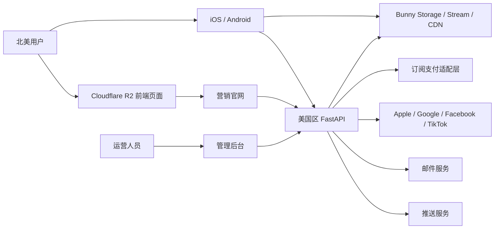
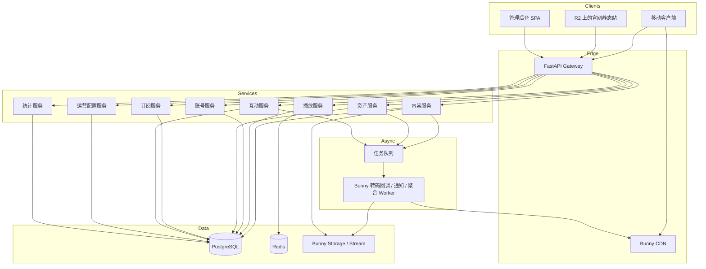
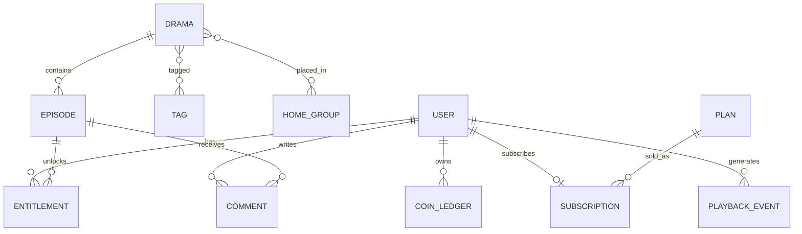
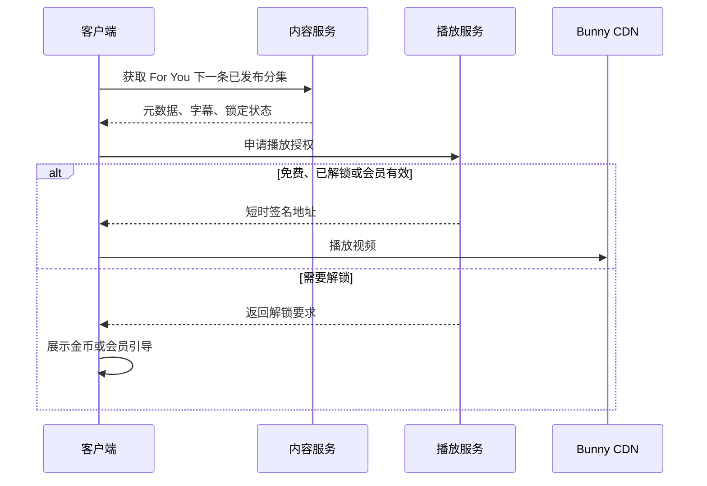
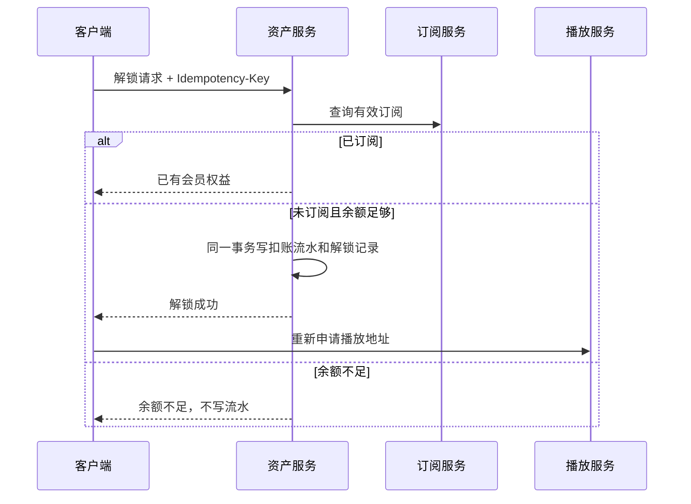
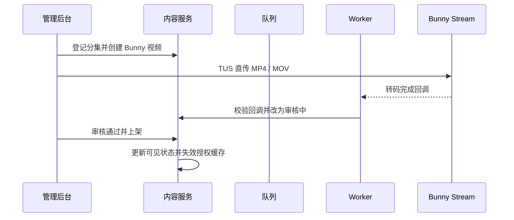
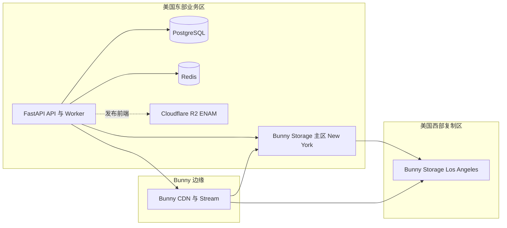

# MiniTV 软件架构设计

状态：已采纳基础设施约束，供研发评审  
日期：2026-10-13  
技术约束：美国区服务器、FastAPI、Bunny Storage / Stream / CDN、Cloudflare R2 前端静态托管  
读者：客户端、后端、管理后台、测试  
依据：App 设计稿 file `735952778351359`，官网与管理后台设计稿 file `735989669924027`  
配套文档：[技术架构](technical-architecture.md)、[前后端开发文档](../output/minitv-devdoc-20261013/stage3/MiniTV%20前后端开发文档.docx)

## 1. 架构目标

MiniTV 是面向北美市场的竖屏短剧系统。架构要同时满足四件事：

1. 推荐流进入后直接播放，免费集不要求登录。
2. 金币解锁和会员订阅的扣费、授权结果实时一致，不能因重试重复扣费。
3. 内容发布、转码、审核异步进行，但客户端只能看到已上架剧集和已发布分集。
4. 客户端、官网、管理后台读取同一份内容和价格配置，文案可切换英文与中文。

本文只设计实现上述已确认能力所需的软件结构。支付服务商、离线下载、系统设置、推送人群定向不进入本期架构。

## 2. 系统上下文

三端都不直接访问数据库。官网不提供登录、播放和支付，只读取公开内容和下载配置。

## 3. 容器与职责

| 容器 | 职责 | 不负责 |
|---|---|---|
| FastAPI Gateway | 鉴权、限流、语言、幂等键、请求追踪 | 业务状态判断 |
| FastAPI 领域模块 | 内容、播放、账号、资产、订阅、互动、运营、统计 | 视频转码和文件分发 |
| Bunny Stream | 原片存储、转码、HLS、播放流量 | 业务权限判断 |
| Bunny Storage + CDN | 封面、字幕和图片流量 | 前端 HTML、正片转码 |
| Cloudflare R2 | 官网和管理后台 HTML、CSS、JS | 视频、封面原文件、业务数据 |
| 内容服务 | 剧集、分集、标签、审核状态、搜索索引 | 播放授权 |
| 播放服务 | 播放地址签发、进度、完播、字幕 | 内容编辑 |
| 账号服务 | 第三方登录、邮箱验证码、资料、语言偏好 | 金币账本 |
| 资产服务 | 金币流水、解锁记录、签到、任务、广告奖励 | 订阅价格 |
| 订阅服务 | 套餐、订阅状态、支付回调、权益判断 | 单集扣币 |
| 互动服务 | 点赞、收藏、追剧、评论、关注计数、消息 | 推送人群策略 |
| 运营配置服务 | 首页分组、Tab、Banner、热搜、语言包、官网文案 | 内容审核结论 |
| 统计服务 | 播放量、活跃、营收、完播率的聚合读模型 | 实时扣费 |
| Worker | 转码、截图、通知、统计聚合、索引更新 | 同步请求处理 |

服务可以先以模块化单体部署，但数据表、接口和任务边界按上表拆分。后续独立部署时不改调用契约。

## 4. 关键设计决策

### ADR-006：业务计算留在美国区 FastAPI，媒体交给 Bunny

- 状态：已采纳
- 上下文：产品面向北美，视频存储和播放流量是主要成本；业务需要强一致的解锁和订阅判断。
- 决策：API、Worker、PostgreSQL、Redis 部署在美国区。封面和字幕使用 Bunny Storage，经 Bunny CDN 分发。正片上传到 Bunny Stream，由 Bunny 转码并输出 HLS，播放流量全部走 Bunny CDN。前端 HTML、CSS、JS 不放 Bunny。
- 理由：Bunny Stream 已提供上传、多清晰度转码、自适应播放、目录级 Token 和边缘分发，不需要自建转码集群。FastAPI 继续掌握用户、金币、订阅和内容状态。
- 后果：业务服务器不中转视频文件。Bunny 不判断用户是否已解锁，正式播放地址仍由 FastAPI 签发短时目录 Token。

### ADR-008：前端 HTML 托管在 Cloudflare R2

- 状态：已采纳
- 上下文：官网和管理后台都是静态前端，发布频繁；视频和图片流量已经由 Bunny 承担。
- 决策：构建产物上传到 Cloudflare R2，桶的 Location Hint 使用 `ENAM`。生产环境通过自定义域名公开访问，不使用默认的 `r2.dev` 地址。FastAPI 不托管 HTML。
- 理由：R2 适合静态文件，出站流量不计费；页面与视频分属两个供应商，页面发布不会触发 Bunny 视频缓存清理。
- 后果：前端只通过 HTTPS API 访问美国区 FastAPI。R2 桶不保存用户数据、视频原片和密钥。发布时保留上一版构建目录，便于回滚。

### ADR-007：美国区只作为业务区域，不作为播放边缘

- 状态：已采纳
- 上下文：服务器要求位于美国，但用户分布在北美多个网络。
- 决策：计算与主数据固定在美国东部。Bunny Storage 主区使用 New York，复制到 Los Angeles。播放由 Bunny 全球边缘节点就近分发。
- 理由：上传和回调靠近业务服务器，西海岸复制降低美国西部回源延迟，边缘节点承担播放流量。
- 后果：数据库不跨云区域做同步写入。新增区域前先评估 Bunny 复制区，不先拆 FastAPI。

### ADR-001：播放授权与内容查询分离

- 状态：已采纳
- 上下文：免费集要快速起播，锁定集又必须防止绕过客户端直接获取地址。
- 决策：内容接口只返回可见元数据；正式播放地址只由 FastAPI 播放模块签发 Bunny 目录级 HMAC Token，默认 5 分钟过期，并校验地区、年龄分级、上架状态、会员或解锁记录。
- 理由：把“看不看得见”和“能不能播”分开，避免详情接口泄露付费地址。
- 后果：播放前多一次授权调用。推荐流可对当前免费集预签发，但地址仍必须短时有效。

### ADR-002：金币使用账本，不覆盖余额

- 状态：已采纳
- 上下文：解锁、签到、广告奖励和后台调账都可能重试。
- 决策：金币余额是流水聚合结果。每笔变动有唯一业务键，重复请求返回原结果。
- 理由：直接更新余额无法审计，也无法防止重复扣费。
- 后果：所有入账和扣账都走资产服务；后台调账必须记录操作人、原因和变动前后余额。

### ADR-003：内容发布异步，可见性同步

- 状态：已采纳
- 上下文：上传、转码和审核不能阻塞运营操作，但下架必须立即在客户端生效。
- 决策：原片直传 Bunny Stream。Bunny 完成转码后回调 FastAPI，分集进入审核中。上架、下架写入内容状态并同步失效播放授权缓存。下架时调用 Bunny Purge 清理封面和播放缓存。
- 理由：媒体处理天然异步，授权判断必须同步。
- 后果：转码失败可重试且状态可见；下架后已签发地址最多存活到其过期时间，建议不超过 5 分钟。

### ADR-004：价格与文案单源配置

- 状态：已采纳
- 上下文：客户端和官网都展示同一组会员价格；客户端文案需要英文、中文切换。
- 决策：套餐价格只在订阅服务维护。界面文案以 key 存在语言包，客户端按 locale 渲染，不把英文硬编码为最终文案。
- 理由：避免两端价格漂移，也避免再次出现英文长度把布局撑破后无法统一修复。
- 后果：新增页面必须先登记文案 key。官网营销数字可单独配置，不直接绑定实时统计。

### ADR-005：统计与交易分库表责任

- 状态：已采纳
- 上下文：看板需要播放量、活跃和营收，但这些指标允许分钟级延迟。
- 决策：交易、解锁、订阅使用事务表；播放量和完播率由事件异步聚合。
- 理由：把高写入播放事件隔离出支付事务。
- 后果：看板数字可延迟，金币余额、解锁结果和订阅状态不可延迟。

## 5. 领域模型

核心不变量：

| 规则 | 约束 |
|---|---|
| 可见性 | 客户端查询只返回已上架剧集、已发布分集 |
| 解锁唯一 | `(user_id, episode_id, entitlement_type)` 唯一 |
| 金币不透支 | 扣账事务内校验余额，失败不写负余额 |
| 会员优先 | 有效订阅不创建金币解锁、不扣币 |
| 分组容量 | 一个首页分组最多 20 部剧 |
| 删除保护 | 删除剧集前检查分组、Banner、推送引用，确认后不可从普通列表恢复 |
| 语言完整 | 每个文案 key 至少有 `en`，缺失时回退英文并记录告警 |

剧集状态：草稿、审核中、已上架、已下架。分集状态：未上传、转码中、转码失败、审核中、已发布。删除不作为普通状态，单独走不可恢复操作。

## 6. 核心链路

### 6.1 推荐流起播

推荐服务不保存独立内容副本。它消费内容服务发布的可见内容事件，只保存排序特征。

### 6.2 金币解锁

幂等键由客户端生成，服务端保留至少 24 小时。超时重试必须复用同一键。

### 6.3 内容上传与发布

上传限制沿用设计稿：MP4 / MOV、竖版、单文件不超过 200MB。Bunny Stream 自动生成自适应清晰度，播放页展示 360P、720P；1080P 是否仅向会员签发仍是待确认项，FastAPI 按权益选择可返回的档位，不在客户端写死。

### 6.4 订阅状态

支付回调只进入订阅服务。订阅服务验证通知、更新订阅状态、写订单，再发布权益变更事件。客户端查询权益时以订阅服务为准，不信任本地缓存超过一次播放会话。

价格修改写入套餐版本。新购买使用新版本，已购订阅保持原有效期和原权益快照，避免运营改价影响存量用户。

## 7. 接口边界

后端使用 FastAPI，对外统一使用 `/v1`，管理接口使用 `/admin/v1`。Gateway、领域模块和 Worker 共享同一套 Pydantic 模型与服务层，可在一个 Python 项目中按模块部署，也可拆成多个进程。所有写请求携带 `Idempotency-Key` 和 `X-Request-Id`。

| 分组 | 代表接口 | 所属服务 | 一致性 |
|---|---|---|---|
| 公开内容 | 首页、榜单、搜索、详情 | 内容 + 运营配置 | 可短缓存 |
| 播放 | 授权、进度、完播、字幕 | 播放 | 授权实时 |
| 账号 | 第三方登录、验证码、资料 | 账号 | 实时 |
| 资产 | 解锁、签到、任务、流水 | 资产 | 强一致 |
| 订阅 | 套餐、购买校验、状态 | 订阅 | 强一致 |
| 互动 | 点赞、收藏、评论、消息 | 互动 | 计数可延迟，审核状态实时 |
| 后台 | 剧集、分集、标签、分组、订单、调账 | 对应领域服务 | 写后读一致 |

客户端不调用统计服务。看板接口只对后台开放。

## 8. 数据存储

| 存储 | 数据 | 原因 |
|---|---|---|
| PostgreSQL | 用户、剧集、分集、订单、流水、订阅、配置 | 需要事务和唯一约束 |
| Redis | 播放授权缓存、验证码、限流、热点首页 | 短期状态和热点读 |
| Bunny Stream | 原片、转码产物、HLS 分片 | 正片存储和播放流量 |
| Bunny Storage | 封面、字幕 | 图片流量走 Bunny CDN |
| Cloudflare R2 | 官网和管理后台的 HTML、CSS、JS | 前端页面托管，Location Hint 为 ENAM |
| 搜索索引 | 剧名、标签、简介 | 搜索和后台筛选 |
| 聚合表 | 日活跃、播放量、营收、完播率 | 看板读模型 |

业务时区使用 `America/Los_Angeles`，数据库存储 UTC。日报接口返回时区，避免前后端各自切日。

金币流水建议按月分区，播放事件按日分区。交易表不按播放量膨胀。

## 9. 安全与权限

| 角色 | 权限 |
|---|---|
| 游客 | 浏览公开内容、播放免费集 |
| 登录用户 | 资产、互动、资料、付费播放 |
| 运营 | 内容、配置、评论、推送记录 |
| 财务 | 订单、订阅、金币流水读取 |
| 管理员 | 调账、删除剧集、角色管理 |

删除剧集、调账和套餐改价属于高风险操作，必须二次确认并写审计日志。播放地址使用 Bunny Advanced Token Authentication 的目录级 HMAC-SHA256 Token，绑定分集目录、过期时间和允许国家，不使用永久公开 URL。封面和字幕使用独立 Pull Zone，避免图片 Token 可以换取正片。

邮箱验证码、第三方登录和支付回调都要限流。验证码只保存哈希，不保存明文。

## 10. 可用性与容量

首期容量按设计稿量级规划，不提前拆成无边界的微服务：

| 场景 | 目标 |
|---|---|
| 内容库 | 约 1,200 部剧，单部 55 至 78 集 |
| 推荐起播 | 已缓存免费内容时，授权与地址签发不依赖转码链路 |
| 上传 | 200MB 原片直传对象存储，API 不中转文件 |
| 转码 | Bunny Stream 转码，FastAPI 只接收回调并重试状态回写 |
| 看板 | 允许 1 至 5 分钟延迟 |
| 播放地址 | 建议 5 分钟过期，下架时主动失效缓存 |

故障隔离：

1. 统计服务不可用不影响播放、解锁和订阅。
2. 转码队列积压不影响已发布内容播放。
3. 搜索索引延迟时，详情和播放仍走主库。
4. 支付回调失败进入重试队列，订阅状态以最后一次已验证通知为准。

## 11. 部署视图

客户端通过应用商店分发。官网和管理后台的 HTML、CSS、JS 发布到 Cloudflare R2，使用自定义域名访问。管理后台 API 只访问美国区 FastAPI。公开 API 与后台 API 可以使用同一个 FastAPI 进程，通过路由依赖分开限流和权限。

FastAPI 运行时使用 Uvicorn 和多 Worker。异步任务使用进程内队列或 Redis 队列，不把视频二进制读入 API 进程。Bunny 回调接口单独限流，并校验 Bunny 签名或共享密钥。

环境至少分为开发、预发、生产。生产配置不写入客户端安装包，价格、文案、下载地址和功能开关从服务端读取。

## 12. 可观测性

每个请求保留 `X-Request-Id`，跨网关、服务和 Worker 传播。

必须有的指标：

| 指标 | 告警关注点 |
|---|---|
| 播放授权成功率 | 付费内容突然无法起播 |
| 解锁幂等冲突数 | 重试或重复扣费 |
| 金币账本差额 | 余额与流水不一致 |
| Bunny 转码回调延迟 | 上传后长期停留在转码中 |
| Bunny 流量与存储用量 | 异常盗链或单文件成本飙升 |
| 订阅回调延迟 | 支付成功但权益未生效 |
| 下架缓存失效延迟 | 下架内容仍可播放 |

日志不记录验证码、支付凭证、播放签名和第三方 token。

## 13. 测试架构

测试按边界而不是按页面数量组织：

1. 契约测试：公开 API 与后台 API 的字段、状态码、幂等行为。
2. 状态机测试：剧集、分集、订阅、金币流水的合法迁移和非法迁移。
3. 权限测试：游客、用户、运营、财务、管理员。
4. 一致性测试：重复解锁、重复签到、重复支付回调。
5. 可见性测试：草稿、审核中、下架内容不能出现在客户端和官网。
6. 国际化测试：英文、中文语言包 key 完整，缺失时回退英文。

端到端验收仍以开发文档中的 12 条验收清单为准。

## 14. 实施顺序

1. 建立账号、内容、资产、订阅四份事务模型和唯一约束。
2. 接通 Bunny Storage、Bunny Stream、上传回调、审核、上架和下架。
3. 接通播放授权、免费播放和金币解锁。
4. 接通首页配置、语言包、搜索和客户端主要页面。
5. 接通订阅回调、订单和套餐版本。
6. 最后接入统计聚合、看板、评论审核和消息。

这个顺序保证内容闭环和扣费闭环先成立，避免先做看板和运营页面却没有可信交易数据。

## 15. 待确认后才能冻结的决策

| 项目 | 当前架构处理 | 未冻结风险 |
|---|---|---|
| 支付渠道 | 订阅服务后留支付适配层 | 影响回调协议和取消订阅入口 |
| Download 按钮 | 播放设置保留不可用状态，不建下载服务 | 产品确认后可能隐藏或延期 |
| 年龄分级标准 | 内容保留地区和分级字段 | 影响播放授权规则 |
| 1080P 权益 | Bunny 可产出多档，FastAPI 按权益签发 | 影响播放流量成本和会员权益 |
| 官网数据条 | 独立营销配置 | 不应直接读取实时统计 |

这些项目确认前，不新增对应服务，也不把临时枚举写死在客户端。
