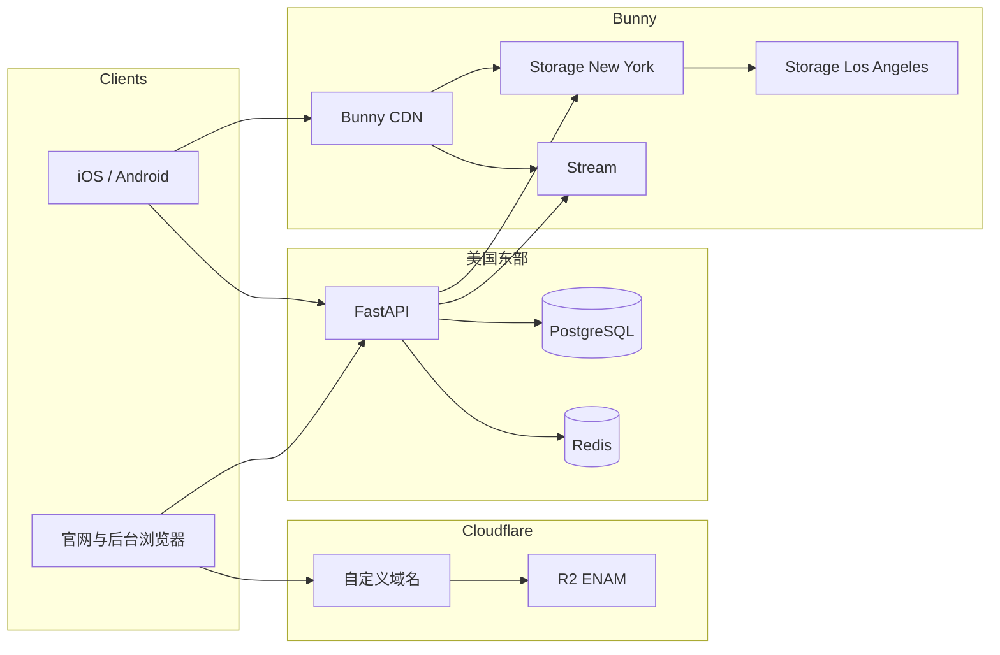
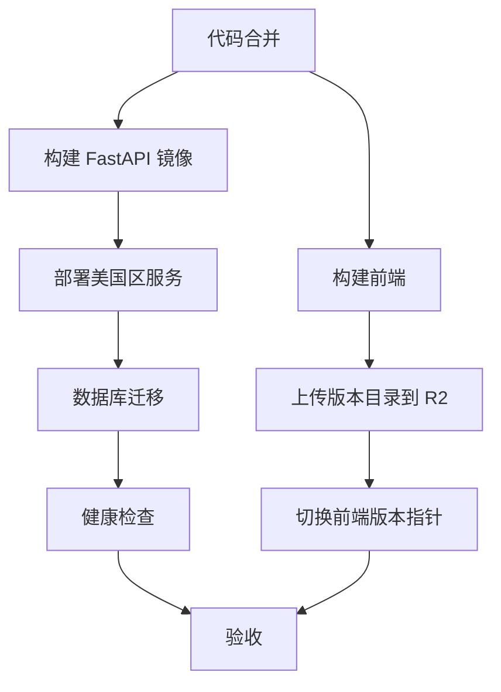

# MiniTV 技术架构

状态：已采纳  
日期：2026-10-13  
读者：后端、前端、运维、测试  
配套文档：[软件架构设计](software-architecture.md)、[TikTok 小程序前端规划](tiktok-minis-frontend-plan.md)

## 1. 技术结论

MiniTV 的技术架构按四层固定：

| 层 | 选型 | 部署位置 |
|---|---|---|
| 业务计算 | FastAPI + PostgreSQL + Redis | 美国东部服务器 |
| 正片与播放流量 | Bunny Stream + Bunny CDN | Bunny 边缘 |
| 封面与字幕 | Bunny Storage + Bunny CDN | 主区 New York，复制 Los Angeles |
| 前端页面 | Cloudflare R2 | Location Hint `ENAM`，自定义域名公开访问 |

FastAPI 决定用户能不能看。Bunny 负责视频存储、转码和流量。R2 只负责 HTML、CSS、JS。三类凭据、缓存和发布流程互不混用。

## 2. 技术拓扑



## 3. 运行时

### 3.1 FastAPI

后端使用一个 Python 项目，按模块划分内容、播放、账号、资产、订阅、互动、运营和统计。对外路由是 `/v1`，后台路由是 `/admin/v1`。

运行组件：

| 组件 | 选择 | 说明 |
|---|---|---|
| Web 框架 | FastAPI | 承载 API 和 Bunny 回调 |
| ASGI Server | Uvicorn | 多 Worker，不在 API 进程内转码 |
| 数据校验 | Pydantic | API、回调和任务共用模型 |
| 数据库 | PostgreSQL | 事务、唯一约束和审计 |
| 缓存 | Redis | 验证码、限流、授权缓存、队列 |
| 配置 | 环境变量 | 不把密钥写入镜像或前端包 |

写请求必须携带 `Idempotency-Key` 和 `X-Request-Id`。金币、签到、订阅回调和后台调账使用数据库唯一约束保证幂等，不只依赖应用内存。

### 3.2 异步任务

API 进程不读取视频二进制。上传由客户端或后台直传 Bunny。FastAPI 只创建上传会话、接收回调、校验签名和更新状态。

通知、统计聚合和失败重试使用 Redis 队列。队列积压不影响已发布内容播放。

## 4. Bunny 技术边界

### 4.1 Storage

Bunny Storage 保存封面、字幕和需要由图片 CDN 分发的媒体文件。主区使用 New York，复制区使用 Los Angeles。

上传使用 Storage 的区域 HTTP API：

```text
PUT https://ny.storage.bunnycdn.com/{zone}/{path}/{filename}
AccessKey: {storage-zone-password}
```

Storage Zone Password 只保存在美国区服务器的密钥管理中。它不是 Bunny 账号 API Key，也不进入前端。

### 4.2 Stream

正片上传到 Bunny Stream。Bunny 完成多清晰度转码并生成 HLS。FastAPI 保存 Bunny Video ID、状态和分集对应关系，不保存视频文件。

上传使用可恢复上传。转码完成后 Bunny 回调 FastAPI，服务端校验回调密钥，然后把分集从转码中改为审核中。

### 4.3 CDN 与 Token

播放流量使用 Bunny CDN。正式播放地址由 FastAPI 签发目录级 HMAC-SHA256 Token，默认 5 分钟过期，可限制国家。一个分集的播放列表和分片使用同一目录 Token。

封面、字幕和正片使用不同 Pull Zone。图片授权不能换取正片授权。下架时删除 FastAPI 授权缓存，并调用 Bunny Purge 清理对应缓存。

## 5. Cloudflare R2

R2 只保存前端构建产物：

| 内容 | 允许 | 禁止 |
|---|---|---|
| 官网 HTML、CSS、JS | 是 | — |
| 管理后台 HTML、CSS、JS | 是 | — |
| 用户数据、视频、封面原文件 | 否 | 禁止上传 |
| API 密钥和 Bunny 凭据 | 否 | 禁止写入构建产物 |

桶创建时使用 Location Hint `ENAM`。生产访问使用自定义域名，不使用 `r2.dev` 默认地址。R2 桶保持私有写入，只给 CI 使用最小权限的 S3 兼容凭据。

发布目录按版本保存，例如 `releases/{git-sha}/`，域名指向当前版本。回滚只切换当前版本指针，不覆盖上一版本。

前端环境只包含公开 API 地址和公开 CDN 域名，不包含数据库、R2 Secret 或 Bunny 签名密钥。

## 6. 环境与区域

| 环境 | FastAPI | 数据 | 媒体 | 前端 |
|---|---|---|---|---|
| 开发 | 美国开发服务器或本地 | 独立数据库 | 独立 Bunny Library / Storage Zone | 独立 R2 桶 |
| 预发 | 美国预发服务器 | 独立数据库 | 独立 Bunny 资源 | 独立域名 |
| 生产 | 美国东部生产服务器 | 生产数据库 | 生产 Bunny 资源 | 生产自定义域名 |

开发、预发、生产的 Bunny Library、Storage Zone、R2 Bucket 和数据库必须分开。不允许用生产 Token 在本地签发可播放地址。

## 7. 密钥与网络

| 密钥 | 保存位置 | 使用方 |
|---|---|---|
| PostgreSQL 密码 | 美国区密钥管理 | FastAPI |
| Redis 密码 | 美国区密钥管理 | FastAPI |
| Bunny Account API Key | 美国区密钥管理 | 后端管理操作 |
| Bunny Storage Password | 美国区密钥管理 | 后端上传封面和字幕 |
| Bunny Stream API Key | 美国区密钥管理 | 后端创建视频和接收回调 |
| Bunny Token Key | 美国区密钥管理 | FastAPI 签发播放地址 |
| R2 Access Key | CI 密钥管理 | 前端发布 |
| 支付与第三方登录密钥 | 美国区密钥管理 | FastAPI |

公网只开放 HTTPS 的 API、Bunny CDN 和 R2 自定义域名。PostgreSQL 和 Redis 不开放公网。Bunny 回调接口单独限流，并校验签名或共享密钥。

## 8. 发布流程



数据库迁移先于前端切换。回滚前端不回滚已经完成的不可逆数据迁移；这类迁移必须采用向后兼容的两阶段变更。

## 9. 观测与容量

必须监控：

| 信号 | 来源 | 判断 |
|---|---|---|
| API 延迟和错误率 | FastAPI | 美国区服务健康 |
| 数据库连接与慢查询 | PostgreSQL | 事务瓶颈 |
| 队列长度 | Redis | 回调或聚合积压 |
| Bunny 转码回调延迟 | FastAPI | 上传后的处理健康 |
| Bunny 存储与流量 | Bunny | 盗链或异常成本 |
| R2 请求错误 | Cloudflare | 前端发布或域名异常 |

容量目标保持软件架构中的约束：API 不中转 200MB 视频，播放地址 5 分钟过期，看板允许 1 至 5 分钟延迟。

## 10. 技术边界

本期技术架构不包含：

- 自建对象存储、自建转码集群或自建播放 CDN。
- 用 FastAPI 静态目录托管官网或后台。
- 把前端页面放到 Bunny Storage。
- 把视频原片或封面原文件放到 R2。
- 多区域部署 FastAPI 或跨区域同步写入数据库。

支付服务商、1080P 会员限制、年龄分级标准和 Download 按钮仍待产品确认。确认前只保留适配接口和字段，不新增技术组件。

## 11. 客户端技术选型建议

状态：建议修订为 Flutter，待确认。判断标准同时看复杂播放交互和 AI 协作。

建议使用 Flutter 和 Dart，而不是 Swift 加 Kotlin，也不再优先 React Native。

| 方案 | 复杂交互 | AI 友好度 | 原因 |
|---|---|---|---|
| Swift + Kotlin | 最好 | 低 | 播放器原生，但 19 个页面要写两遍 |
| React Native + Expo | 足够 | 高 | TypeScript 语料最多，但竖滑、手势和播放器状态要频繁跨原生边界 |
| Flutter | 更好 | 高，且更适合本项目 | 一套 Widget 和手势代码，播放仍由 AVPlayer / ExoPlayer 承担 |

Flutter 的界面由自有渲染引擎绘制，竖滑切集、选集 Sheet、字幕和按钮叠加层可以在同一套代码里完成。React Native 的播放器仍是原生视图，复杂手势和页面状态同步更容易出现边界问题。播放解码两边都不应自研，Flutter 也调用 AVPlayer 和 ExoPlayer。

AI 友好度上，React Native 的公开语料更多，但不代表对本项目更友好。Flutter 的 Widget 树、强类型和声明式界面更完整，AI 一次改动可以同时覆盖双端，也更容易通过类型和分析器检查。FastAPI 的 OpenAPI 仍可生成 Dart 客户端，类型联动不是 Flutter 的障碍。

因此，MiniTV 这种以竖屏视频交互为核心的产品，Flutter 的综合优势大于 React Native。

增加 TikTok 小程序后，这个结论不变。TikTok Minis 是 Web 应用，必须使用官方 VePlayer；App 使用 Bunny HLS 和原生播放器。两边不能共用播放器、播放凭证和竖滑交互实现。

可以共用的是 FastAPI 业务规则、内容 ID、文案 key 和接口契约，不是页面框架。为了让 App 与 TikTok 页面使用同一种语言而改选 React Native，会牺牲 App 已确认更适合的复杂播放交互，但得不到真正的代码复用。TikTok 前端继续使用 React，App 继续使用 Flutter。

AI 可维护的配套约束：

1. 一个设计页面对应一个屏幕文件，不按人拆分后再合并。
2. API 类型从 FastAPI 的 OpenAPI 生成，不手写重复模型。
3. 文案只放语言包，不把英文字符串写进组件。
4. 播放器接口固定为加载、播放、暂停、跳转、清晰度、字幕和释放；Token 刷新由 Dart 层处理，不把签名逻辑写进播放器插件。
5. 每次 AI 改动必须通过类型检查和一条播放主路径测试。
