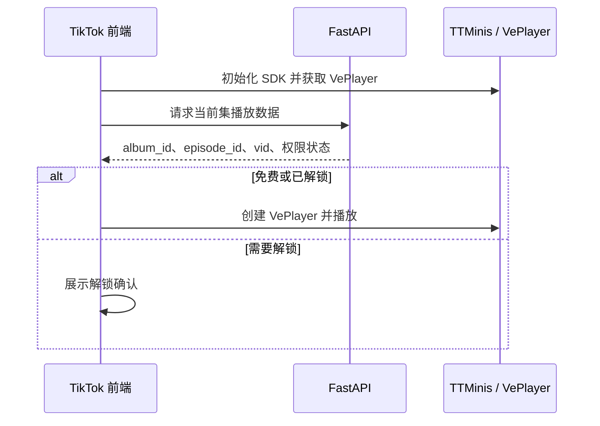

# MiniTV TikTok 小程序前端规划

状态：规划，待确认  
日期：2026-10-13  
读者：前端、后端、产品  
依据：TikTok Minis 官方技术说明与短剧播放器说明  
配套文档：[软件架构设计](software-architecture.md)、[技术架构](technical-architecture.md)

## 1. 规划结论

TikTok 端不复用 Flutter App，也不按微信小程序的页面模型开发。它是运行在 TikTok WebView 中的 Web 应用，前端按标准 Web 工程规划。

前端负责页面、路由、状态和交互。登录、授权、支付、广告和订阅通过 `window.TTMinis` 调用 TikTok 客户端。已审核短剧必须使用官方 VePlayer，禁止第三方播放器和 HTML `video`。

因此，TikTok 前端与 App 共享内容和业务规则，但不共享播放器实现。

## 2. 与现有端的边界

| 能力 | App | TikTok 小程序 |
|---|---|---|
| 技术 | Flutter | React + TypeScript Web |
| 播放器 | AVPlayer / ExoPlayer | TikTok VePlayer |
| 正片来源 | Bunny Stream | 经 TikTok 审核后的 BytePlus 视频 |
| 付费 | 金币与会员 | TikTok Beans，服务端建单 |
| 页面 | 19 屏完整产品 | 先做短剧观看闭环 |

App 的 Bunny 播放链路不能直接嵌入 TikTok。TikTok 端要有独立的视频映射：`album_id`、`episode_id`、`vid` 对应 MiniTV 的剧和分集。

## 3. 前端工程

建议使用 React、TypeScript 和 Vite。官方允许 React、Vue 或原生 H5；选择 React 是为了和 FastAPI OpenAPI 的类型生成配合，不表示复用 Flutter 页面。

工程约束：

1. 构建产物为静态目录，入口是 `index.html`。
2. TikTok Minis SDK 必须是 `<head>` 中的第一个脚本。
3. 页面必须执行 `TTMinis.init({ clientKey })`。
4. 使用 `minis dev` 调试，使用 `minis build` 校验并生成 `minis.zip`。
5. 不使用 `eval`、`new Function` 和 `iframe`。
6. 包体先按 50MB 上限控制，图片和字体外置到已加白名单的 CDN。

`clientKey` 可以出现在前端初始化配置中。任何可换取用户 Token、创建订单或签发播放凭证的密钥都只放在 FastAPI。

## 4. 第一期页面

第一期只规划短剧闭环，不把 App 的 19 个页面全部搬进 TikTok。

| 页面 | 目的 | 不做 |
|---|---|---|
| 剧场首页 | 展示已审核短剧和继续观看 | 不做完整推荐算法页 |
| 剧详情 | 展示封面、简介、集数和免费范围 | 不做评论发布 |
| 播放页 | 使用 VePlayer 播放当前集 | 不自建播放器 |
| 选集层 | 选择免费或已解锁集 | 不在前端判断最终权限 |
| 解锁确认 | 展示 Beans 价格并发起支付 | 不在前端创建订单 |
| 我的 | 展示 TikTok 身份、观看记录和解锁记录 | 不做资料编辑和会员中心 |

竖滑切集如果官方播放器容器限制较多，第一期改为播放页内上一集、下一集和选集层。不要为了复刻 App 的手势而绕过 VePlayer。

## 5. 播放规划

播放数据只在用户确定播放时请求。旧版 TikTok 所需的 `play_auth_token` 有效期有限，不能提前批量签发后缓存。

每个播放器实例使用独立容器，容器尺寸由 CSS 明确给出。切换剧集时销毁旧实例，不在一个容器里叠加多个播放器。

## 6. 登录与支付

登录由前端向 TikTok 获取 code，FastAPI 用 code 换取平台 Token并建立 MiniTV 用户映射。前端不保存平台密钥。

支付流程固定为：

1. 前端请求 FastAPI 创建解锁订单。
2. FastAPI 调用 TikTok Open API 创建交易订单。
3. 前端只拿订单号调用 `TTMinis.pay`。
4. FastAPI 收到 Webhook，验签并确认订单后解锁。
5. 前端刷新权限，再请求播放数据。

前端收到支付成功回调后不能直接解锁。解锁只信任服务端 Webhook。优先使用充值与支付合并的流程，减少余额不足时的跳转。

## 7. 与 FastAPI 的接口

TikTok 前端需要一组独立于 App 的接口：

| 接口 | 作用 |
|---|---|
| `POST /v1/tiktok/login` | 用 code 换登录态 |
| `GET /v1/tiktok/dramas` | 获取已审核短剧 |
| `GET /v1/tiktok/dramas/{id}` | 获取详情、分集和免费范围 |
| `POST /v1/tiktok/playback` | 返回 VePlayer 所需字段和权限 |
| `POST /v1/tiktok/orders` | 服务端创建 Beans 订单 |
| `GET /v1/tiktok/entitlements` | 查询解锁结果 |

这些接口不返回 Bunny 播放地址。App 与 TikTok 的内容状态可以共享，但播放凭证必须按平台分别签发。

## 8. 实施顺序

1. 建立 React 工程、SDK 初始化和 `minis dev` 调试链路。
2. 完成 TikTok 登录与 MiniTV 用户映射。
3. 用一部已审核短剧跑通 VePlayer 播放。
4. 接服务端建单、Beans 支付和 Webhook 解锁。
5. 补剧场、详情、选集和我的页面。
6. 最后评估竖滑切集，只在不替换 VePlayer 的前提下做。

前 4 步完成前，不开发奖励、评论、资料编辑和完整推荐流。

## 9. 待确认

1. TikTok 开发者组织、短剧类目权限和审核环境是否已开通。
2. 现有剧集是否已通过 TikTok 内容审核并取得 `vid`。
3. Beans 与 MiniTV 金币、会员之间是否打通，还是 TikTok 端单独计价。
4. 当前包体上限、域名白名单和可用地区。
5. VePlayer 是否允许在保留官方播放器的同时自定义上一集、下一集和选集层。
