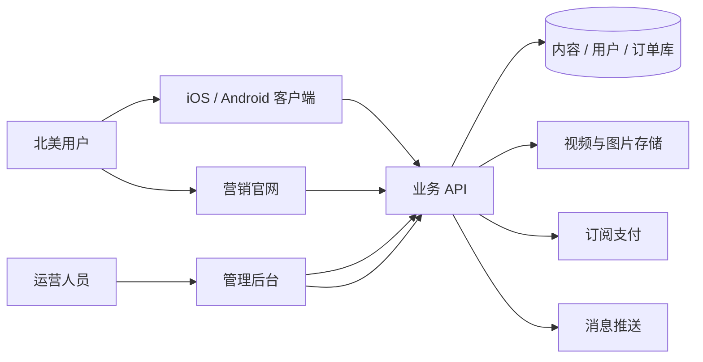
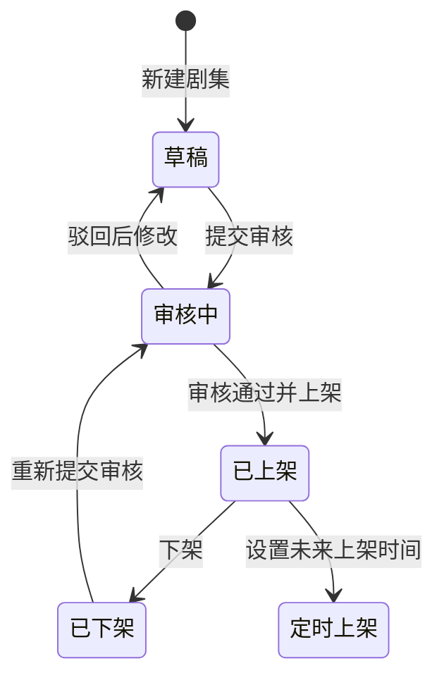
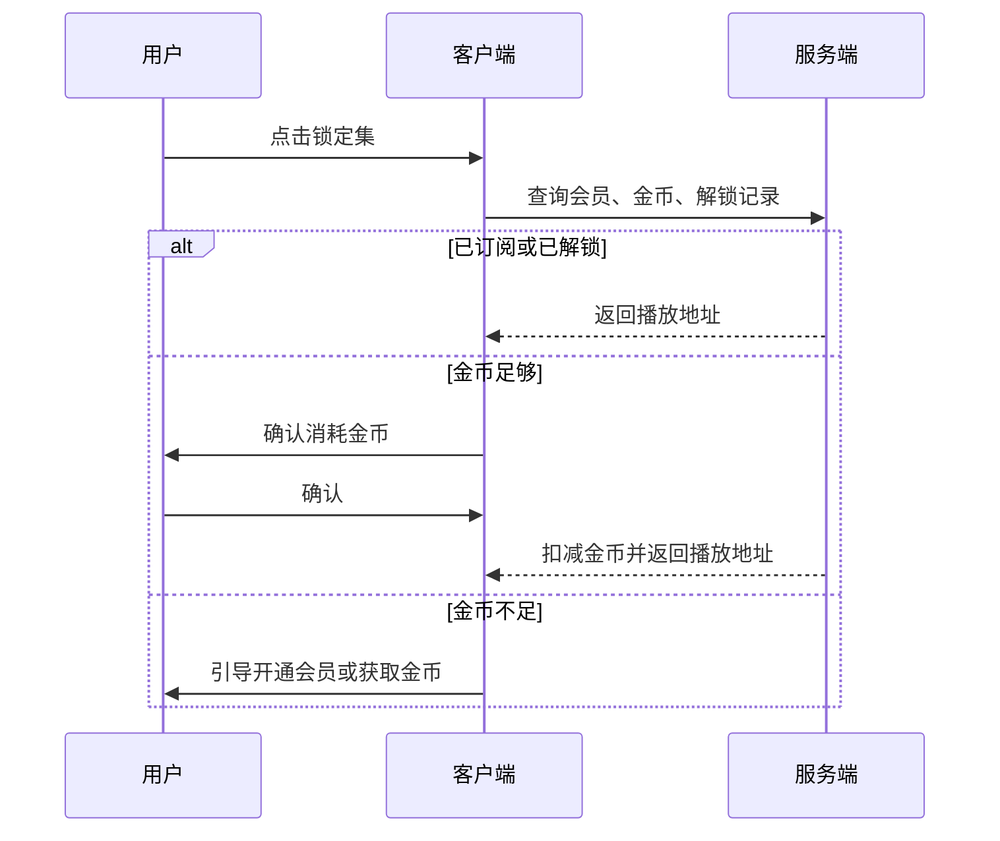

# MiniTV 前后端开发文档

## 一句话描述

MiniTV 是面向北美市场的竖屏短剧产品，由 iOS / Android 客户端、营销官网、管理后台三端组成；本文把两份设计稿里已经确定的页面、字段、状态和交互，整理成可直接排期的开发说明。

## 文档范围与设计依据

本文只覆盖设计稿里已经画出来的能力。设计稿没有出现的功能不进入本期范围，避免开发按猜测补功能。

| 端 | 设计稿 | 范围 |
|---|---|---|
| 客户端 | MiniTV App 设计稿，file 735952778351359 | 19 屏，360pt 宽 |
| 官网 | MiniTV · 官网，file 735989669924027 | 单页营销站 |
| 管理后台 | 同文件，1440 × 900 | 现行 16 屏；旧版剧集管理 4 屏已归档，不作为开发依据 |

客户端 19 屏：发现、榜单、新剧、登录、奖励、推荐、详情、播放、播放详情·选集、播放详情·简介、播放详情·设置、我的、搜索、搜索结果、消息、注册、编辑资料、金币明细、开通会员。

管理后台现行 16 屏：登录、数据看板、用户管理、剧集列表、剧集工作台（基本信息 / 分集 / 首页分组 / 发布与下架）、标签库、运营中心、首页运营、选择剧集、金币与任务、评论审核、财务订单、会员套餐。侧边栏中的「系统设置」只有入口，没有页面，本期不实现。

## 读者与实现边界

- 目标读者：客户端、后端、管理后台和测试工程师。
- 前置约定：客户端默认英文，后台默认中文；客户端文案必须可切换语言包。
- 技术栈版本：本文不绑定框架版本。数据模型、状态机和接口契约优先于具体框架。
- 预计阅读时间：35 分钟。

## 产品约束

1. 市场是北美。价格用美元，客户端默认语言是英文，年龄分级样例为 17+，地区样例为美国、加拿大。
2. 内容形态是竖屏短剧。样例单集约 1 分 30 秒到 2 分钟，一部剧 55 到 78 集。
3. 变现只有两条路径：金币单集解锁，会员订阅解锁全站。
4. 客户端底部导航固定 4 项：首页、推荐、奖励、我。没有商店，也没有下载中心。
5. 未登录可以开始观看免费集。登录、注册、绑定账号用于领取金币和同步资产。

## 系统全景

三端不共享页面，但共享同一套剧集、分集、用户、金币和订阅数据。官网只负责介绍和下载，不承载播放。

## 核心对象

| 对象 | 设计稿中的关键字段 | 说明 |
|---|---|---|
| 剧集 Drama | ID、英文剧名、封面 3:4、简介、标签、总集数、主分类、状态、播放量、更新时间 | 列表与详情的主对象 |
| 分集 Episode | 集号、标题、时长、视频、解锁类型、状态、播放量 | 播放和审核的最小单位 |
| 解锁规则 | 免费集数、之后每集金币数 | 例：前 12 集免费，第 13 集起 50 金币 |
| 标签 Tag | 英文名、中文名、分类、关联剧数、状态 | 后台维护，客户端展示英文 |
| 首页分组 | 展示标题、包含剧集、组内排序、分组排序、状态 | 一部剧可加入多个分组 |
| 频道 Tab | Discover、Ranking、New、English、Asian、Free | 后台可拖动排序 |
| 用户 | 昵称、头像、性别、简介、生日、地区、MiniTV ID | 样例 ID 为 1005816648 |
| 金币流水 | 类型、金额、时间、关联对象、余额 | 收入为正，解锁消耗为负 |
| 订阅 | 周 / 月 / 年、价格、权益、有效期、状态 | 价格以设计稿为准 |
| 评论 | 内容、关联剧集、用户、状态 | 后台审核后才公开展示 |
| 消息 | 类型、标题、正文、时间、已读状态 | 分 Activity 与 System |
| 订单 | 订单号、用户、商品、金额、状态、时间 | 订阅订单与金币消耗分开统计 |

剧集状态以最新工作台为准：草稿、审核中、已上架、已下架。分集状态为未上传、审核中、已发布。首页分组状态样例为展示中、定时上线。

## 状态与关键流程

### 剧集发布

删除不是普通状态。它位于工作台的危险区，确认后清空剧集、全部分集和播放数据，且不可恢复。

### 单集解锁

会员生效期间不扣金币。取消订阅不追溯已发生的金币流水，只影响后续解锁。

### 签到与任务

连续签到按 7 天梯度发放，样例为 +30、+30、+50、+50、+30、+60、+90。中断后回到第 1 天。后台修改梯度后次日生效，避免当天已经签到的用户出现重复结算。

新人激励以设计稿为准：注册 +80，绑定邮箱 +30，绑定 Facebook +80。每日观看广告 +30，每日上限 1 次。

## 客户端开发说明

### 全局

- 画板宽度 360pt，底部导航高固定，内容区独立滚动。
- 默认文案为英文。所有界面字符串进入语言包，至少支持英文和中文切换；切换后不改变布局结构。
- 英文文案普遍长于中文。按钮、标签、Tab 使用自适应宽度，不能按中文长度写死。
- 海报统一 3:4。播放页为竖屏沉浸式，进度、字幕、互动栏叠加在视频上。
- 空态、加载态、失败重试在设计稿中没有单独成屏，按各列表的既有结构补最小状态，不新增信息模块。

### 首页与内容发现

发现、榜单、新剧共用顶部：状态栏、搜索入口、频道 Tab。Tab 顺序由后台下发，客户端不写死。

| 页面 | 模块 | 交互 |
|---|---|---|
| 发现 | 大图 Banner、Must-Watch、Most Popular、Hidden Identity、More For You | 点击卡片进入详情；分组内容、排序和标题以后台配置为准 |
| 榜单 | 排名、海报、剧名、简介、热度 | 排名从 1 开始；点击进入详情 |
| 新剧 | 两列 3:4 海报、剧名、标签 | 点击进入详情 |
| 搜索 | 输入框、取消、搜索历史、Trending | 历史可清空；Trending 支持换一批 |
| 搜索结果 | 结果数、Best Match、剧名、集数、播放量、标签 | 点击进入详情 |

发现页底部展示「No more content」，不使用无限加载时必须有明确结束态。

### 推荐与播放

推荐页是竖滑信息流，进入后直接播放当前集。页面包含 Following / For You、作者头像、点赞、评论、收藏、分享、字幕开关、全屏，以及「Watch Full Series · All N Episodes」。底部展示剧名、当前集和总集数。

播放页展示当前集字幕、倍速、清晰度、互动数据和选集入口。播放详情用三个底部 Sheet 承载，不新开全屏页：

| Sheet | 内容 | 行为 |
|---|---|---|
| 选集 | 分季、1-20 / 21-40 / 41-60 / 61-64 分段、集数网格 | 当前集高亮；锁定集显示锁定标识 |
| 简介 | 简介、标签、相关推荐 | 可切换到选集或同系列 |
| 设置 | 倍速 1x / 1.25x / 1.5x / 2x，清晰度 360P / 720P / 1080P，字幕、清屏、不感兴趣、投射、睡眠定时 | 1080P 受会员权益约束 |

设计稿的播放设置里出现 Download。客户端「我的」页已明确移除下载中心，因此本期不实现离线下载，设置项保留为不可用状态或按产品确认后隐藏。文档不把它扩展成下载模块。

### 详情、解锁与会员

详情页包含剧名、标签、总集数、播放量、追剧、选集、简介、猜你喜欢和底部播放按钮。免费集直接播放；锁定集显示解锁提示，并提供 Unlock All 入口。

开通会员页展示三档：

| 套餐 | 价格 | 设计稿中的权益 |
|---|---|---|
| Weekly | $9.99 / 周 | 全剧解锁、免广告、1080p |
| Monthly | $19.99 / 月 | 周卡权益，另含下载；标记 Best |
| Yearly | $79.99 / 年 | 月卡权益、优先客服、相对周卡节省 58% |

订阅入口必须说明可在 Me › Subscription 取消。支付渠道、税务和地区价本期没有设计稿，接入前需单独确认，不在本文虚构。

### 账号、资产与消息

| 页面 | 字段与动作 | 规则 |
|---|---|---|
| 登录 | Facebook、Google、TikTok、Email | Facebook 首次绑定展示 +80 coins；需同意 Terms 与 Privacy |
| 注册 | 邮箱、验证码、Get Code | 不使用密码；注册奖励 80，任务还可再领 110 |
| 我的 | 头像、昵称、ID、关注 / 粉丝 / 获赞、金币、会员、设置 | 四个内容 Tab：History、Favorites、Likes、My List |
| 编辑资料 | 头像、昵称、性别、简介、生日、地区 | 保存后返回并刷新「我的」 |
| 金币明细 | 当前余额、收入、消耗、时间和来源 | 消耗为负数，收入为正数 |
| 奖励 | 7 日签到、观看广告、明日提醒、新人任务 | 广告每日 1 次；任务完成后按钮变为完成态 |
| 消息 | Activity、System、全部已读 | 未读数同步到「我的」入口 |

关注、粉丝、获赞只按设计稿展示汇总数。设计稿没有关注列表和粉丝列表，本期不新增这两个页面。

## 官网开发说明

官网是单页，顶部导航为 Home、Shows、Premium、About、Download App。

| 区块 | 内容 | 数据来源 |
|---|---|---|
| Hero | 产品主张、下载按钮、评分与下载量 | 运营配置 |
| 数据条 | 5M+ Downloads、1,200+ Dramas、50M+ Episodes watched、4.9★ | 可配置，不直接取实时库，避免营销数字抖动 |
| 功能介绍 | 竖滑播放、金币、会员 | 静态文案 |
| Trending | 6 部剧的封面、集数、播放量 | 读取已上架剧集，或由运营指定 |
| 评价 | 3 条用户评价 | 运营配置；上线前需有真实授权 |
| 价格 | 与客户端相同的三档价格和权益 | 与会员套餐配置保持一致 |
| FAQ | 是否免费、下载位置、金币规则、是否可取消 | 静态内容 |
| 下载 | iOS、Android、二维码 | 应用商店地址配置化 |
| 页脚 | Product、Company、Legal | Terms、Privacy、Cookie Settings 为独立页面入口 |

官网不提供登录、播放、支付和账号管理。价格区按钮只引导下载 App。

## 管理后台开发说明

### 登录与框架

后台使用运营账号和密码登录。登录后框架固定为左侧导航、顶部搜索、通知和当前运营人员。导航为数据看板、剧集管理、用户管理、运营中心、财务订单、系统设置。

顶部搜索只搜索设计稿标明的剧集和用户，不扩展成全局任意对象搜索。

### 数据看板

看板默认展示当天和近 7 天：活跃用户、新增用户、订阅加金币营收、平均完播率、活跃趋势、营收趋势、热剧 TOP 5、近期交易。所有指标必须标注统计口径和时区，北美业务统一使用 America/Los_Angeles，并在接口中返回时区。

### 剧集管理

剧集列表是查找入口，不在行内堆叠编辑、预览、下架。筛选项为剧名 / ID / 标签、分类、状态、最近更新。每行展示封面、剧名、ID、免费集数、单集金币、分类、集数、状态、播放量、最近更新。点击「进入」打开工作台。列表支持导出和分页。

工作台头部固定展示剧名、状态、预览和保存，下面分四个页签。

| 页签 | 可执行操作 | 验收重点 |
|---|---|---|
| 基本信息 | 更换 3:4 封面、编辑剧名和简介、增删标签、设置免费集数与单集金币 | 保存后客户端详情页同步 |
| 分集 | 按全部、已发布、审核中、未上传筛选；搜索；上传；播放、替换视频、改标题、删除 | 64 集可定位，不只展示前几集 |
| 首页分组 | 查看已加入分组、调整组内排序、移出、加入新分组 | 一部剧可出现在多个分组 |
| 发布与下架 | 下架、定时上架、重新提交审核、修改地区和年龄分级、删除 | 删除必须二次确认并说明不可恢复 |

分集上传约束沿用旧交互稿：支持 MP4 / MOV，竖版，建议 16:9 以上清晰度、单文件不超过 200MB。上传后的默认状态是提交审核，不直接公开。

预览必须打开客户端真实播放页，而不是静态封面。预览至少能看到当前集画面、字幕、进度和选集入口。

### 标签、首页与运营

标签库字段为英文名、中文名、分类、关联剧集数、状态，支持新建、编辑、删除。已被剧集使用的标签删除前必须提示影响范围。

首页运营维护频道 Tab 和首页分组。Tab 可拖动排序。分组可新建、编辑标题、调整分组顺序、选择最多 20 部剧，并在组内排序。选择剧集时显示已选数量，确认后才写入分组。

运营中心还包括首页 Banner、热门搜索词和消息推送。Banner 有展示位、关联剧集、投放日期和上线状态。推送记录至少展示内容、送达人数和发送时间。设计稿没有推送编辑器的完整表单，本期只按已展示字段实现记录与新建入口，不补充未画出的定向条件。

评论审核展示评论内容、关联剧集、用户和状态。已发布评论可删除，待审核评论可通过或删除。客户端公开展示的评论必须来自审核通过的数据。

### 用户、金币与财务

用户列表可按昵称或用户 ID 搜索，展示金币余额、会员状态、注册时间，并提供调整金币。调整必须记录操作人、原余额、变动值、原因和时间，不能只覆盖余额。

金币与任务页维护 7 天签到梯度、注册奖励、绑定邮箱、绑定 Facebook、每日广告奖励。保存后的生效时间按「次日生效」执行。

财务订单分订单、订阅、金币流水三个视图。汇总指标为本月营收、有效订阅数、本月金币消耗。订单字段为订单号、用户、商品、金额、状态、时间。订阅订单用美元，单集解锁显示金币。

会员套餐页维护三档价格、权益、有效期和推荐标记。修改后必须同时作用于客户端开通会员页和官网价格区。

## 接口清单

以下是实现上述页面所需的最小接口，路径仅为分组建议，字段名应与核心对象保持一致。

| 分组 | 接口 | 使用方 |
|---|---|---|
| 内容 | 获取频道、首页分组、榜单、新剧、搜索、详情、相关推荐 | 客户端、官网 |
| 播放 | 获取播放地址、上报进度、上报完播、获取字幕 | 客户端 |
| 解锁 | 查询解锁状态、金币解锁、会员解锁校验 | 客户端 |
| 账号 | 第三方登录、邮箱验证码、注册、资料读写、退出 | 客户端 |
| 资产 | 签到、任务、广告奖励、金币流水、会员状态 | 客户端 |
| 互动 | 点赞、收藏、追剧、评论、关注、消息已读 | 客户端 |
| 后台内容 | 剧集 CRUD、分集上传与状态流转、标签、分组、Banner | 管理后台 |
| 后台经营 | 看板、用户、金币调整、任务配置、评论审核、订单、套餐、推送记录 | 管理后台 |

写接口必须具备幂等键。金币解锁、签到、广告奖励和后台调账尤其不能因重试重复入账。

## 数据与一致性规则

1. 客户端只接收已上架剧集和已发布分集。审核中、草稿、下架内容只能在后台和授权预览中出现。
2. 播放量、完播率异步聚合，允许分钟级延迟；金币余额、解锁结果、订阅状态必须实时一致。
3. 解锁记录以用户、剧集、分集唯一。重复解锁直接返回已解锁，不重复扣费。
4. 删除剧集采用不可恢复删除前，先检查订阅权益展示、首页分组、Banner 和推送引用，并在确认文案中列出影响。
5. 语言包按 key 管理。新增界面文字先加 key，再分别提供英文和中文，不允许把英文硬编码为最终文案。
6. 价格只在会员套餐配置中维护一份，客户端和官网读取同一配置。

## 非功能要求

| 项目 | 要求 | 依据 |
|---|---|---|
| 播放启动 | 推荐页进入后直接播放，首屏不应先落入静态详情 | 推荐页交互 |
| 视频规格 | MP4 / MOV，竖版，单文件不超过 200MB | 上传交互 |
| 安全 | 播放地址限时签名；后台操作写审计日志 | 付费内容与运营操作 |
| 可用性 | 上传、转码、审核异步执行，失败可重试且状态可见 | 分集状态机 |
| 国际化 | 英文为默认长度基准，关键按钮允许两行以内，不重叠 | 已发生的英文溢出问题 |
| 统计时区 | 后台日报按 America/Los_Angeles 切日 | 北美市场 |

## 验收清单

1. 未登录用户可从发现、榜单、新剧、搜索进入详情并播放免费集。
2. 锁定集在无会员、无解锁记录时不能取得正式播放地址。
3. 金币足够时只扣一次；余额不足时不产生负余额。
4. 注册只接受邮箱和验证码，不出现密码字段。
5. 签到中断后从第 1 天重新计算；广告奖励同一天不能领取两次。
6. 后台可新建剧、上传任意集、替换视频、修改标题，并按状态筛选 64 集。
7. 一部剧可加入多个首页分组，组内排序和分组排序分别生效。
8. 下架后客户端立即不可见；删除有二次确认，且不能从普通列表恢复。
9. 后台预览打开的是真实播放页，不是封面图。
10. 套餐价格修改后，客户端与官网显示一致。
11. 英文和中文切换后，19 个客户端页面没有文字重叠、裁切或溢出。
12. 官网不能播放视频、不能登录、不能支付。

## 本期不包括

- 管理后台「系统设置」的具体功能。
- 离线下载中心、下载任务和本地文件管理。
- 关注列表、粉丝列表、评论发布页的完整线程。
- 推送的人群定向、A/B 实验和到达率分析。
- 多币种、税务、应用商店分成和具体支付服务商接入。
- 设计稿归档区中的旧版剧集列表、旧版编辑弹窗和旧版删除确认。

## 待确认项

1. 订阅支付由 Apple、Google 还是自有支付承载，以及取消订阅的实际入口。
2. 播放设置中的 Download 是隐藏、置灰，还是仅对会员展示但暂不开发。
3. 年龄分级使用北美哪一套标准，以及 17+ 是否为全站默认值。
4. 转码是否必须产出 360P、720P、1080P 三档，成员权益如何限制 1080P。
5. 营销官网的数据条使用人工配置值还是定期同步真实数据。

## 元信息

- 目标读者：负责 MiniTV 客户端、官网、管理后台和接口的开发与测试人员。
- 前置知识：短剧付费解锁、订阅状态、内容审核、多语言界面。
- 设计依据：MiniTV App 设计稿 file 735952778351359；官网与管理后台 file 735989669924027。
- 技术栈版本：不限定；接口和状态以本文为准。
- 预计阅读时间：35 分钟。
